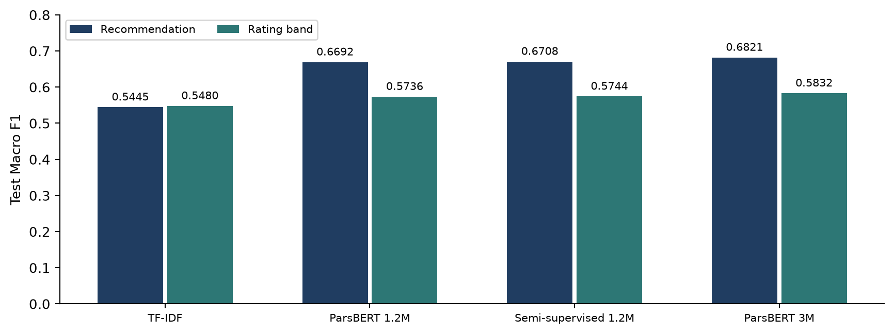

> # گزارش نهایی پروژه ۳ تحلیل نظرات دیجی کالا
>
> عماد نعمتی | آبان ۱۴۰۵
>
> ## چکیده
>
> در این پروژه بررسی کردم که از متن یک نظر تا چه حد می شود پیشنهاد خرید و بازه امتیاز کاربر را حدس زد. برای تحلیل داده همه ۶٬۱۵۶٬۲۸۹ نظر را بررسی کردم. مدل پایه را با TF-IDF و Logistic Regression ساختم و بعد ParsBERT را روی Colab آموزش دادم. مدل نهایی در مرحله آخر روی ۳ میلیون نظر آموزش دید. در آزمون Macro F1 پیشنهاد خرید از ۰٫۵۴۴۵ در مدل پایه به ۰٫۶۸۲۱ و Macro F1 بازه امتیاز از ۰٫۵۴۸۰ به ۰٫۵۸۳۲ رسید. اضافه کردن `pseudo-label` به مدل ۱٫۲ میلیونی تغییر کوچکی داشت. مشکل اصلی در تفسیر نتیجه این بود که با وجود جدایی محصولات هنوز بخشی از متن های آزمون در آموزش تکرار شده بودند.
>
> # ۱ مقدمه
>
> سوال من این بود که آیا خود نظر برای تشخیص پیشنهاد خرید و بازه امتیاز کافی است. هر دو مدل فقط ستون `body` را می بینند. عنوان و اطلاعات محصول و فروشنده و امتیاز عددی وارد مدل نمی شوند. خروجی اول یعنی `recommendation_status` پیشنهاد خرید یا عدم پیشنهاد یا بی نظر است. بی نظر یک برچسب ثبت شده است و با برچسب خالی فرق دارد. خروجی دوم یعنی `rating_band` یکی از سه بازه پایین از صفر تا کمتر از ۲٫۵ و متوسط از ۲٫۵ تا کمتر از ۴ و بالا از ۴ تا ۵ است. پیش بینی امتیاز دقیق و بخش اختیاری API خارج از دامنه این نسخه بودند.
>
> # ۲ محیط اجرا و روش کار
>
> سیستم شخصی من برای آموزش `Transformer` روی این حجم داده مناسب نبود. تحلیل داده و مدل پایه را در نشست CPU انجام دادم و برای ParsBERT به GPU نوع Tesla T4 در Colab رفتم. فایل نظرات حدود ۱٫۲۸ گیگابایت بود. خواندن مرحله ای CSV و استفاده از DuckDB کمک کرد همه متن ها را یکجا در حافظه نگه ندارم. برای شمارش نظرها ردیف های CSV را خواندم چون بعضی متن ها چند خط دارند.
>
> برای هر مدل از همان تقسیم داده و معیارهای یکسان استفاده کردم. معیار اصلی Macro F1 بود که به هر کلاس وزن برابر می دهد. Accuracy و Balanced Accuracy و نتیجه هر کلاس را هم ثبت کردم. Balanced Accuracy میانگین Recall کلاس هاست. برای امتیاز یک معیار ترتیبی هم داشتم. فاصله پایین تا بالا دو و فاصله بین بازه های مجاور یک است. این فاصله بر حسب بازه است و خطای امتیاز خام نیست. برای هر هدف فقط ردیف های دارای برچسب معتبر آن هدف را سنجیدم.
>
> # ۳ بررسی و تمیزسازی داده
>
> اول فقط فیلدهای خالی را شمردم و مقدار متنی `nan` از قلم افتاد. بعد از اصلاح شمارش ۶۳۷ متن گمشده و ۸۹۴٬۴۲۶ توصیه گمشده پیدا شد. توصیه برای همه ۳۰۲٬۱۸۱ نظر غیرخریداران خالی بود. در خریداران این رقم ۱۰٫۱۲ درصد بود. بنابراین گروه طبیعی بدون برچسب را معادل یک نمونه تصادفی از نظرهای برچسب دار فرض نکردم.
>
> | مورد در داده خام | نتیجه |
> | --- | --- |
> | ساختار فایل | ۶٬۱۵۶٬۲۸۹ نظر با ۱۵ ستون و بدون ردیف بدشکل |
> | تعداد محصول و فروشنده | ۳۳۱٬۵۹۹ محصول و ۲۹٬۲۱۳ کد فروشنده غیرگمشده |
> | ستون های کم داده | عنوان ۴۶٫۵۶٪ و مزایا ۸۸٫۵۰٪ و معایب ۹۳٫۳۰٪ گمشده |
> | طول متن | میانه ۶ واژه و صدک ۹۵ برابر ۳۲ واژه |
> | نظرهای خیلی کوتاه | ۲۷٫۲۲٪ حداکثر ۳ واژه |
> | تمرکز نظرها | یک درصد محصولات ۱۰٫۸۵٪ کل نظرها را دارند |
>
> در امتیازها یک مقدار ۲۵۰۰ پیدا کردم و بازه آن را نامعتبر گذاشتم. امتیاز صفر را طبق تعریف پروژه در بازه پایین نگه داشتم. در بررسی خطا چند متن مثبت با امتیاز صفر دیده شد. از روی متن نمی شد فهمید صفر عمدی بوده یا در ثبت امتیاز مشکل پیش آمده است.
>
> ۳٬۲۲۶ شناسه تکراری و ۳٬۲۲۹ ردیف اضافه وجود داشت. در ۲۴۱ شناسه چند متن متفاوت بود و کل آن گروه را کنار گذاشتم. اگر شناسه و متن یکی بودند ردیف ها را ادغام کردم. در موارد اختلاف برچسب معتبر فقط هدف متعارض را خالی گذاشتم. پس از ادغام ۱۶ برچسب توصیه و ۱۵ برچسب بازه به این دلیل خالی شدند. نتیجه پاک سازی ۶٬۱۵۲٬۱۸۲ نظر با شناسه یکتا بود.
>
> تکرار شناسه با تکرار جمله فرق داشت. ۱۹۷٬۷۴۴ متن متمایز بیش از یک بار در فایل خام دیده شدند. برای ۳۱٬۹۴۱ متن تکراری توصیه و برای ۸۲٬۶۱۹ متن بازه امتیاز یکسان نبود. حذف همه تکرارهای متنی رفتار واقعی کاربرها را عوض می کرد. آنها را نگه داشتم و اشتراک متن ها بین آموزش و آزمون را اندازه گرفتم. حدود ۷۹٪ توصیه های معتبر مثبت بودند و حدود ۶۵٪ امتیازها در بازه بالا قرار داشتند. به همین دلیل در آموزش از وزن کلاس استفاده کردم.
>
> # ۴ پیش پردازش متن فارسی
>
> قاعده را ساده نگه داشتم. ی و ک عربی را فارسی کردم و فاصله های اضافی و تگ های HTML را پاک کردم. نشانی اینترنتی با `[URL]` جایگزین شد. عدد و ایموجی و کلمه های نفی را نگه داشتم. حذف نیست از کیفیت کالا خوب نیست نتیجه را برعکس می کند. نیم فاصله داخل واژه در ورودی مدل حفظ شد. چهار آزمون نرمال سازی گذشت و برای آموزش و پیش بینی از یک تابع مشترک استفاده کردم.
>
> # ۵ تقسیم داده و Label Masking
>
> اگر ردیف ها را تصادفی تقسیم می کردم نظرهای یک محصول ممکن بود هم در آموزش و هم در آزمون قرار بگیرند. با هش `product_id` و بذر ۲۰۲۶ هر محصول را کامل به یکی از سه بخش دادم. نسبت ردیف ها حدود ۷۰ و ۱۵ و ۱۵ درصد شد. توزیع کلاس ها در سه بخش نزدیک بود. مثلاً سهم توصیه مثبت در آموزش ۷۹٫۰۸٪ و در آزمون ۷۹٫۳۱٪ بود.
>
> | مجموعه یا فایل | تعداد نظر |
> | --- | ---: |
> | آموزش پیش از `label masking` | ۴٬۳۰۷٬۳۱۰ |
> | آموزش `supervised` | ۳٬۵۷۰٬۷۶۵ |
> | مخزن با برچسب پنهان | ۷۳۶٬۵۴۰ |
> | آموزش طبیعی بدون توصیه | ۶۲۴٬۵۸۶ |
> | اعتبارسنجی | ۹۲۵٬۱۹۷ |
> | آزمون | ۹۱۹٬۶۷۵ |
>
> در هر کلاس توصیه آموزش ۲۰٪ از ردیف ها را با هش ثابت انتخاب کردم. متن و شناسه این ردیف ها در مخزن آزمایش باقی ماندند و هدف های واقعی به مدل `semi-supervised` داده نشدند. پاسخ اصلی را بعد از آموزش برای ممیزی برگرداندم. نظرهای طبیعی بدون توصیه در صورت داشتن امتیاز معتبر می توانستند برای `rating_head` در آموزش `supervised` استفاده شوند. بنابراین ردیف طبیعی و آموزش `supervised` در جدول الزاماً جدا نیستند.
>
> با تقسیم محصولی اشتراک شناسه محصول از بین رفت ولی عبارت هایی مثل خوب بود بین محصول ها تکرار شدند. در مقایسه آزمون با زیرمجموعه نهایی سه میلیونی ۳۱۰٬۰۴۱ ردیف یا ۳۳٫۷۱٪ متن کاملاً یکسان با آموزش داشتند. نتیجه آزمون را با در نظر گرفتن همین محدودیت گزارش می کنم.
>
> # ۶ مدل پایه TF-IDF و Logistic Regression
>
> روی ۳٬۵۷۰٬۷۶۵ متن آموزشی یک واژگان مشترک TF-IDF ساختم و برای هر هدف یک Logistic Regression جدا آموزش دادم. از واژه تکی و حداقل حضور در پنج متن و سقف ۶۰ هزار ویژگی استفاده کردم. ۵۵٬۳۶۵ ویژگی به دست آمد. `sparse matrix` حدود ۲۶۴ MiB بود و ۶٬۱۰۵ متن هیچ ویژگی فعالی نداشتند. مدل برای این متن ها عملاً از ضرایب مربوط به واژه ها کمکی نمی گیرد.
>
> گزینه `solver` برابر `SAGA` و `class_weight` برابر `balanced` و مقدار C برابر ۱ بود. هر دو مدل در سقف ۶۰ تکرار هشدار `ConvergenceWarning` دادند. اجرای ذخیره شده را به عنوان مرجع نگه داشتم و جستجوی C یا آموزش تا همگرایی کامل انجام ندادم. بنابراین تفاوت نتیجه را فقط به نوع معماری نسبت نمی دهم.
>
> Accuracy پیشنهاد خرید در آزمون ۰٫۸۱۱۶ بود ولی Recall کلاس بی نظر فقط ۰٫۰۹۲۷ بود. یعنی مدل از هر صد نمونه واقعی این کلاس حدود ۹ مورد را پیدا کرد. همین اختلاف نشان داد چرا Accuracy به تنهایی کافی نیست. برای یک پیش بینی مشخص هم سهم واژه ها در اختلاف امتیاز دو کلاس اول قابل محاسبه بود. مثلاً در متن منفی نمونه آفلاین نمی کنم به امتیاز عدم پیشنهاد کمک کرد.
>
> # ۷ Fine-tuning مدل ParsBERT
>
> ## انتخاب مدل و max_length
>
> از `BertTokenizer` همراه `ParsBERT` استفاده کردم. این `tokenizer` با روش `WordPiece` متن را به واژه یا تکه های واژه می شکند و به هر تکه یک شناسه عددی می دهد.
>
> از مدل فارسی `HooshvareLab/bert-fa-base-uncased` شروع کردم. یک `encoder` مشترک و دو `classification head` سه کلاسه ساختم. نمایش `[CLS]` به هر دو `classification head` داده می شد. فقط بلوک آخر `encoder` و هر دو `classification head` را آموزش دادم. حدود ۷٫۱ میلیون از ۱۶۲٫۳ میلیون پارامتر تغییر می کردند. موقع بارگذاری اولیه هشدار وزن های اضافی پیش آموزش را دیدم. این کلیدها مربوط به `pretraining heads` و `pooler` بودند. برای پروژه دو `classification head` جدید ساختم.
>
> در نمونه ۲۰ هزارنفری میانه طول ۹ توکن و صدک ۹۵ برابر ۳۹ بود. طول ۶۴ حدود ۱٫۳۰٪ متن ها و طول ۹۶ حدود ۰٫۴۳٪ را می برید. برای کلاس عدم پیشنهاد نرخ برش در ۹۶ هنوز ۰٫۹۹٪ بود. طول ۹۶ و دسته ۶۴ را انتخاب کردم. اجرای کوتاه روی T4 حدود ۰٫۹۱ GiB حافظه تخصیص یافته نشان داد. برای برآورد زمان آموزش طولانی از زمان ثبت شده هر مرحله استفاده کردم.
>
> ## مراحل آموزش و مشکل نشست ها
>
> مقدار `learning rate` برای `encoder` برابر 0.00002 و برای هر دو `classification head` برابر 0.0002 بود. با AdamW و `mixed precision` آموزش دادم. برای هر `classification head` تابع `cross-entropy loss` فقط روی ردیف های دارای برچسب معتبر حساب شد. مدل اولیه سه دور روی ۱۲۰ هزار نظر آموزش دید. یک دور روی ۱٫۲ میلیون و یک دور دیگر روی ۳ میلیون نظر از وزن مرحله قبل ادامه پیدا کرد. زیرمجموعه ها با هش ثابت انتخاب شدند و بهینه ساز در آغاز مرحله های ادامه دوباره ساخته شد. مدل آخر سه دور روی سه میلیون نظر آموزش ندیده است.
>
> | مرحله | Macro F1 توصیه | Macro F1 امتیاز |
> | --- | ---: | ---: |
> | ۱۲۰ هزار دور اول | 0.6412 | 0.5452 |
> | ۱۲۰ هزار دور دوم | 0.6515 | 0.5560 |
> | ۱۲۰ هزار دور سوم | 0.6543 | 0.5534 |
> | ادامه روی ۱٫۲ میلیون | 0.6638 | 0.5718 |
> | ادامه روی ۳ میلیون | 0.6765 | 0.5832 |
>
> این جدول از همان ۲۰ هزار نظر اعتبارسنجی برای انتخاب وزن است. میانگین دو هدف در دور دوم و سوم پس از گرد کردن ۰٫۶۰۳۸ بود و دور سوم با مقدار گردنشده کمی بالاتر انتخاب شد. مرحله ۱٫۲ میلیونی حدود ۲۸ دقیقه و مرحله سه میلیونی حدود ۶۳ دقیقه طول کشید. روی کل اعتبارسنجی هم مدل سه میلیونی به ۰٫۶۸۲۴ و ۰٫۵۸۴۶ رسید. نتیجه آزمون را بعد از انتخاب مدل گزارش کردم.
>
> هنگام رفتن به نوت بوک semi-supervised با پیام Too many sessions روبرو شدم. نشست قبلی را از بخش مدیریت نشست های Colab خاتمه دادم. فایل های `/content` موقتی بودند. تقسیم ها و وزن ها را در Google Drive نگه داشتم و در نشست تازه ورودی ها را از `digikala_inputs.tar.gz` برگرداندم. برای مرحله سه میلیونی امکان ذخیره بین بلوک ها را گذاشتم تا در صورت قطع نشست کل آن دور از ابتدا اجرا نشود. ارزیابی کامل هم نزدیک بیست دقیقه طول می کشید و چاپ معیارها در پایان انجام می شد.
>
> # ۸ Semi-supervised Learning با Pseudo-labeling
>
> مدل والد ۱٫۲ میلیونی برای ۷۳۶٬۵۴۰ نظر بدون برچسب مصنوعی پیش بینی کرد. با شرط احتمال حداقل ۰٫۹۰ تعداد ۲۷۹٬۳۶۳ نظر پذیرفته شد. یک دور دیگر روی همان ۱٫۲ میلیون نظر و نمونه های پذیرفته شده آموزش دادم. `pseudo-label` فقط برای هدف توصیه استفاده شد و برای این ردیف ها هدف بازه امتیاز خالی بود.
>
> | کلاس پیشنهادی مدل | پذیرفته شده | درست پس از ممیزی | درصد درست |
> | --- | ---: | ---: | ---: |
> | پیشنهاد خرید | 256,238 | 253,468 | 98.92% |
> | عدم پیشنهاد | 22,594 | 20,437 | 90.45% |
> | بی نظر | 531 | 361 | 67.98% |
> | کل | 279,363 | 274,266 | 98.18% |
>
> دقت ۹۸٫۱۸٪ فقط برای نظرهای پذیرفته شده است. بیش از ۹۱٪ نمونه های پذیرفته شده در کلاس پیشنهاد خرید بودند. برای بی نظر هم نمونه کم بود و هم حدود یک سوم برچسب های پذیرفته شده اشتباه بودند. بعد از آموزش Macro F1 آزمون توصیه ۰٫۰۰۱۶ و Macro F1 امتیاز ۰٫۰۰۰۷ بالا رفت. همزمان فاصله ترتیبی از ۰٫۴۳۲۰ به ۰٫۴۳۵۳ رسید که افت این معیار بود. مدل کنترل با یک دور آموزش اضافی بدون `pseudo-label` و تکرار با چند بذر اجرا نشد. بنابراین سهم `pseudo-label` را نمی توانم از سهم آموزش بیشتر جدا کنم.
>
> # ۹ تحلیل خطا
>
> ۲۴ نمونه از یک زیرمجموعه ثابت ۲۰ هزارنفری آزمون برای بررسی حالت های مختلف انتخاب شد. هشت نمونه دیگر از ۲۵۶ نامزد نفی و کنایه آمد. جستجوی متنی ساده برای تعیین کنایه کافی نبود. مثلاً ولی در معمولی یا به به در خوبه به نسبت علامت اشتباه می ساخت. متن را خواندم و مواردی مثل انتخاب عالی برای نخریدن را از جمله های غافلگیری مثبت جدا کردم. تعداد نمونه های جدول برای تخمین فراوانی خطا در کل آزمون مناسب نیست.
>
> در جدول فقط هدف هایی را نوشته ام که مدل منتخب در آنها با برچسب واقعی فرق داشت. سمت اول برچسب واقعی و سمت دوم پیش بینی است. خلاصه متن برای جا گرفتن در جدول کوتاه شده و شناسه ها به نمونه کامل در فایل های تحلیل خطا اشاره دارند.
>
> | شناسه نظر | واقعی / پیش بینی | مشاهده من |
> | --- | --- | --- |
> | 51046284 | توصیه پیشنهاد / بی نظر | خیلی متوسط هست شدت رضایت را می گوید و تکلیف خرید را روشن نمی کند |
> | 34264659 | توصیه عدم پیشنهاد / بی نظر | نمیدونم در شروع متن آمده ولی ادامه چند عیب جدی را نام می برد |
> | 43279550 | توصیه بی نظر / عدم پیشنهاد | خشک و غیر قابل انعطاف است ولی کاربر گزینه بی نظر را ثبت کرده |
> | 25761394 | امتیاز پایین / بالا | از چسب دار بودن تعریف کرده ولی امتیاز در بازه پایین است |
> | 17937444 | امتیاز متوسط / پایین | از بسته بندی شکایت کرده و بازه متوسط گرفته است |
> | 23313616 | امتیاز بالا / پایین | متن از کتاب تعریف می کند و مدل بازه پایین داده است |
> | 33359536 | امتیاز پایین / متوسط | معمولی به تنهایی فرق امتیاز دو با بازه متوسط را روشن نمی کند |
> | 43349539 | امتیاز بالا / متوسط | به قیمتش می ارزه رضایت نسبی است ولی امتیاز ثبت شده بالاست |
> | 13644798 | توصیه پیشنهاد / بی نظر | بد نیست در مقایسه مسواک ها به معنی رضایت محدود است |
> | 6805470 | توصیه پیشنهاد / عدم پیشنهاد و امتیاز متوسط / پایین | از بوی عطر تعریف کرده ولی در پایان می گوید ارزش خرید ندارد |
> | 29087639 | توصیه پیشنهاد / بی نظر | ماندگاری را پسندیده و از تیزی بو گفته است |
> | 10424313 | توصیه پیشنهاد / بی نظر و امتیاز بالا / متوسط | کتاب را پسندیده ولی ترجمه را بد دانسته است |
> | 45275211 | امتیاز پایین / متوسط | گرانی نسبت به بیرون را مطرح می کند و توصیه معتبر ندارد |
> | 39398883 | توصیه بی نظر / عدم پیشنهاد | عدم توصیه برای نوزاد مشخص است ولی برچسب کلی بی نظر است |
> | 19756647 | امتیاز پایین / بالا | خوب و مناسب بود با امتیاز صفر ثبت شده است |
> | 44415035 | امتیاز بالا / متوسط | نسبت به قیمتش خوبه با امتیاز بالا ثبت شده است |
> | 45148985 | امتیاز بالا / متوسط | متن از ارزش خرید می گوید و توصیه ثبت نشده است |
> | 52286501 | امتیاز متوسط / بالا | خوب بود شدت رضایت لازم برای تشخیص بازه را روشن نمی کند |
> | 31192420 | امتیاز بالا / متوسط | تعریف از کالا به قیمت و مصرف روزانه محدود شده است |
> | 40294020 | امتیاز بالا / متوسط | نسبتبه به صورت چسبیده آمده و متن از به صرفه بودن می گوید |
> | 22231863 | امتیاز پایین / بالا | نتیجه ترکیب رنگ را خوب دانسته ولی امتیاز صفر است |
> | 54064030 | امتیاز متوسط / بالا | رضایت بچه ها را گفته ولی بازه ثبت شده متوسط است |
> | 34515850 | امتیاز بالا / متوسط | رضایت و محدودیت کالا را با هم توضیح داده است |
> | 49445857 | امتیاز بالا / متوسط | خوبه به نسبت رضایت مشروط است و نمونه قطعی کنایه نیست |
> | 4556881 | توصیه پیشنهاد / بی نظر و امتیاز بالا / متوسط | پولتون حروم نشده تعریف مشروط است و نفی به نارضایتی اشاره ندارد |
> | 38963367 | توصیه بی نظر / پیشنهاد و امتیاز پایین / بالا | با وجود توصیه صریح در متن برچسب بی نظر و امتیاز پایین است |
> | 43140293 | توصیه عدم پیشنهاد / پیشنهاد | انتخاب عالی برای نخریدن کنایه منفی است |
> | 26876483 | امتیاز متوسط / بالا | از خرید دوباره گفته ولی بازه ثبت شده متوسط است |
> | 45340776 | امتیاز بالا / پایین | کنسول را پسندیده و از کارت جانبی بد گفته است |
> | 10606665 | امتیاز متوسط / بالا | فکر نمی کردم این قدر خوب باشد بیان غافلگیری مثبت است |
> | 14966530 | امتیاز پایین / بالا | درباره مزیت اقتصادی و محیط زیستی نوشته ولی امتیاز پایین است |
> | 14544941 | امتیاز بالا / پایین | نخرید ضرر کردید احتمالاً توصیه فشرده است و مرجع توصیه ندارد |
>
> مدل برای بعضی نظرها معنی متن را درست گرفته ولی برچسب دیگری ثبت شده است. مثلاً در نمونه ۳۸۹۶۳۳۶۷ کاربر صریحاً گفته پیشنهاد میکنم و مدل هم پیشنهاد داده ولی گزینه ثبت شده بی نظر است. در مقابل برای انتخاب عالی برای نخریدن `recommendation_head` مدل اشتباه کرد حتی با وجود اینکه `rating_head` بازه پایین را درست داد. مدل پایه هم گاهی بهتر بود. در نمونه کتاب خوبی بود راضی بودم مدل پایه بازه بالا را درست پیش بینی کرد و ParsBERT بازه پایین داد. این سه مورد را نمی شود با یک توضیح مثل ضعیف بودن مدل یا اشتباه بودن داده جمع کرد.
>
> # ۱۰ پیش بینی آفلاین و نمایش
>
> اسکریپت `predict.py` هر دو مدل را با فایل محلی اجرا می کند و برچسب و احتمال سه کلاس را می دهد. چهار نمونه مثبت و مردد و منفی و ترکیبی را روی CPU کولب با دانلود غیرفعال اجرا کردم. در جمله کیفیت ساخت خوبه ولی باتری زود تموم میشه و قیمتش بالاست مدل پایه پیشنهاد و ParsBERT بی نظر دادند. این نمونه برچسب مرجع ندارد و برای نمایش تفاوت خروجی است. زمان مدل در اولین نمونه حدود ۴۵۵ میلی ثانیه و برای سه نمونه بعد حدود ۱۲۴ تا ۱۳۶ میلی ثانیه بود. این چهار اندازه گیری برای نتیجه گیری درباره سرعت همه سیستم ها کافی نیست.
>
> # ۱۱ بحث و محدودیت ها
>
> | مدل | F1 توصیه | F1 امتیاز | Accuracy توصیه | Accuracy امتیاز | فاصله ترتیبی |
> | --- | ---: | ---: | ---: | ---: | ---: | ---: |
> | TF-IDF | 0.5445 | 0.5480 | 0.8116 | 0.6330 | 0.4851 |
> | ParsBERT 1.2M | 0.6692 | 0.5736 | 0.7991 | 0.6707 | 0.4320 |
> | semi-supervised 1.2M | 0.6708 | 0.5744 | 0.8016 | 0.6645 | 0.4353 |
> | ParsBERT 3M | 0.6821 | 0.5832 | 0.8134 | 0.6799 | 0.4107 |
>

>
> برای توصیه ۷۸۵٬۷۷۶ هدف معتبر و برای امتیاز ۹۱۹٬۶۷۳ هدف معتبر در آزمون وجود داشت. Balanced Accuracy مدل منتخب به ترتیب ۰٫۷۳۷۳ و ۰٫۵۸۸۰ بود. در توصیه Accuracy نسبت به مدل پایه تقریباً ثابت ماند ولی F1 بی نظر از ۰٫۱۵۴۵ به ۰٫۴۳۴۸ و F1 عدم پیشنهاد از ۰٫۵۶۳۸ به ۰٫۷۰۸۰ رسید. در مقابل Recall پیشنهاد خرید از ۰٫۹۰۴۲ به ۰٫۸۵۰۴ پایین آمد. بیشترین مشکل توصیه هنوز جدا کردن بی نظر از دو کلاس دیگر بود. برای امتیاز هم کلاس متوسط با F1 برابر ۰٫۴۲۸۶ سخت ترین کلاس بود.
>
> نمره آزمون عملکرد روی محصول های جدا را در حضور متن تکراری نشان می دهد. برای متن های کاملاً تازه ارزیابی جدا ندارم. گمشدگی توصیه به وضعیت خرید مربوط بود و نتیجه توصیه روی نظرهای دارای برچسب سنجیده شد. از طرف دیگر مدل پایه به سقف تکرار رسید و مدل ها تاریخچه آموزش یکسان نداشتند. اجرای آفلاین را بررسی کردم ولی اجرای یکپارچه هر چهار نوت بوک از ابتدا در یک نشست تازه آزمون نشده است.
>
> # ۱۲ نتیجه گیری و کارهای آینده
>
> مدل سه میلیونی را انتخاب کردم چون روی اعتبارسنجی و آزمون بهترین نمره را بین اجراهای من داشت. تفاوت اصلی در تشخیص عدم پیشنهاد و بی نظر دیده شد. تشخیص بازه امتیاز سخت تر بود چون جمله مشابه یا حتی یکسان همیشه به امتیاز یکسان نمی رسید. مرحله بعد برای من ارزیابی روی متن های بدون تکرار و رساندن مدل پایه به همگرایی است. برای سنجش اثر `pseudo-label` هم یک دور آموزش اضافی بدون `pseudo-label` را با همان داده اجرا می کنم تا مقایسه منصفانه تر شود.
>
> # پیوست الف چالش تحویل
>
> در سامانه سقف هر فایل ۱۰۰ مگابایت بود و وزن کامل `encoder` به تنهایی حدود ۶۴۹ مگابایت بود. گزارش و بسته سبک کد و نوت بوک ها و خروجی ها و `checkpoint` های فشرده را آماده کردم. فایل کامل `encoder` و تقسیم های CSV از لینک بسته کامل در `DELIVERY.txt` قابل دریافت هستند.
>
> # پیوست ب فایل ها و اجرای پروژه
>
> | فایل یا پوشه | کاربرد |
> | --- | --- |
> | `01_descriptive_analysis.ipynb` | تحلیل کل داده و آماده سازی تقسیم ها |
> | `02_baselines.ipynb` | آموزش و ارزیابی مدل پایه |
> | `03_transfer_learning_finetuning.ipynb` | اندازه گیری طول و تنظیم ParsBERT |
> | `04_semi_supervised.ipynb` | `pseudo-label` و ارزیابی و آماده کردن مدل آفلاین |
> | `split_manifest.json` | قواعد تقسیم و ماسک و تعدادهای ثبت شده |
> | `reports/` | معیارهای کامل و ماتریس ها و نمونه های خطا |
>
> برای پیش بینی آفلاین ابتدا پوشه `models` را از بسته کامل در ریشه پروژه قرار دهید. مدل از فایل های محلی بارگذاری می شود.
>
```bash
python -m pip install -r requirements.txt
python predict.py --demo --device cpu
```
>
> # پیوست ج معیارهای هر کلاس مدل منتخب
>
> | کلاس | Precision | Recall | F1 | تعداد |
> | --- | --- | --- | --- | --- |
> | پیشنهاد | 0.9637 | 0.8504 | 0.9035 | 623,237 |
> | عدم پیشنهاد | 0.6437 | 0.7865 | 0.7080 | 74,456 |
> | بی نظر | 0.3496 | 0.5749 | 0.4348 | 88,083 |
> | پایین | 0.5684 | 0.4820 | 0.5216 | 161,005 |
> | متوسط | 0.3735 | 0.5029 | 0.4286 | 157,505 |
> | بالا | 0.8203 | 0.7792 | 0.7992 | 601,163 |
>
> ردیف های ماتریس برچسب واقعی و ستون ها پیش بینی مدل هستند. مقادیر از `parsbert_supervised_3000k_test.json` خوانده شده اند.
>
> ## ماتریس پیشنهاد خرید
>
> | واقعی / پیش بینی | پیشنهاد | عدم پیشنهاد | بی نظر |
> | --- | --- | --- | --- |
> | پیشنهاد | 529,979 | 12,296 | 80,962 |
> | عدم پیشنهاد | 2,633 | 58,559 | 13,264 |
> | بی نظر | 17,321 | 20,121 | 50,641 |
>
> ## ماتریس بازه امتیاز
>
> | واقعی / پیش بینی | پایین | متوسط | بالا |
> | --- | --- | --- | --- |
> | پایین | 77,605 | 34,646 | 48,754 |
> | متوسط | 24,423 | 79,204 | 53,878 |
> | بالا | 34,510 | 98,222 | 468,431 |
>
> جزئیات مدل های دیگر و گزارش کلاس ها در فایل های آزمون JSON موجود است.
>
> # منابع
>
> فایل نظرات عمومی دیجی کالا
>
https://huggingface.co/datasets/RadeAI/Digikala_comments_products/tree/main
>
> مدل اولیه ParsBERT
>
https://huggingface.co/HooshvareLab/bert-fa-base-uncased
>
> کد پروژه و خروجی های آزمایش
>
https://github.com/emadnemati/digikala-review-analysis
