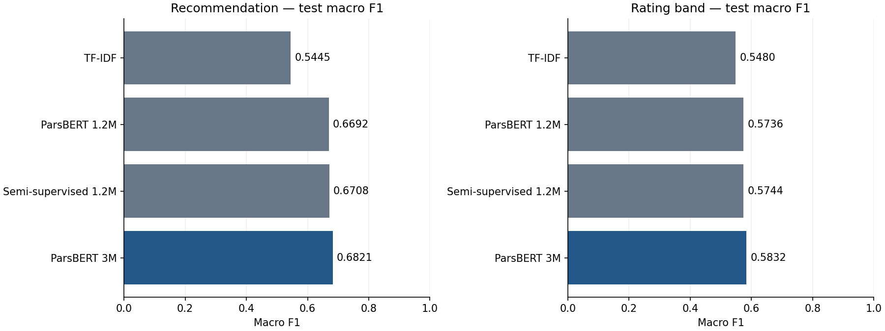

> # گزارش تحلیل نظرهای دیجی‌کالا
>
> ## مسئله و داده
>
> ورودی مدل فقط متن نظر در ستون `body` است. دو خروجی داریم، پیشنهاد خرید در سه کلاس
> `recommended`، `not_recommended` و `no_idea`،
> و بازهٔ امتیاز در سه کلاس `low`، `medium` و `high`.
>
> فایل نظرات ۶٬۱۵۶٬۲۸۹ رکورد و ۱۵ ستون دارد. شمارش با خوانندهٔ `CSV` انجام شد.
> ۳۳۱٬۵۹۹ محصول و ۲۹٬۲۱۳ کد فروشندهٔ غیرخالی مشاهده شد.
> این شمارش‌ها از خروجی بررسی کامل داده در نوت‌بوک اول ثبت شده‌اند.
> اندازه و هش فایل منبع در `split_manifest.json` ثبت شده‌اند.
>
> | ستون | نوع استنباط‌شده با بررسی کل فایل |
> | --- | --- |
> | `id` | `NUMBER` |
> | `title` | `STRING` |
> | `body` | `STRING` |
> | `created_at` | `STRING` |
> | `rate` | `NUMBER` |
> | `recommendation_status` | `STRING` |
> | `is_buyer` | `bool` |
> | `product_id` | `NUMBER` |
> | `advantages` | `STRING` |
> | `disadvantages` | `STRING` |
> | `likes` | `NUMBER` |
> | `dislikes` | `NUMBER` |
> | `seller_title` | `STRING` |
> | `seller_code` | `STRING` |
> | `true_to_size_rate` | `STRING` |
>
> ## یافته‌های تحلیل اولیه
>
> - برچسب پیشنهاد خرید برای ۸۹۴٬۴۲۶ رکورد، معادل ۱۴٫۵۳٪، غایب است.
> - این برچسب در ۱۰۰٪ نظرات غیرخریداران و ۱۰٫۱۲٪ نظرات خریداران غایب است.
> - از نظرهای دارای برچسب، ۷۹٫۱۱٪ خرید را پیشنهاد می‌کنند. بازهٔ امتیاز بالا ۶۵٫۰۵٪ امتیازهای معتبر را دارد.
> - میانهٔ طول متن ۶ واژه و صدک ۹۵ آن ۳۲ واژه است. ۲۷٫۲۲٪ متن‌های غیرخالی حداکثر ۳ واژه دارند.
> - میانهٔ تعداد نظر هر محصول ۴ است. یک درصد از محصولات ۱۰٫۸۵٪ نظرات را دارند.
> - ۳٬۲۲۹ ردیف اضافه با شناسهٔ تکراری مشاهده شد. ۲۴۱ شناسه چند متن متفاوت داشتند.
> - یک امتیاز خارج از دامنه با مقدار ۲۵۰۰ مشاهده شد. دامنهٔ معتبر پروژه صفر تا پنج است.
>
> جدول‌های مقادیر غایب، توزیع‌ها و چهار نمودار در نوت‌بوک اول قرار دارند.
> این یافته‌ها مبنای تقسیم محصولی، وزن‌دهی کلاس‌ها، گزارش `Macro F1` و بررسی طول توکن‌ها بودند.
>
> ## پاک‌سازی و تقسیم
>
> متن‌های خالی و مقدار متنی `nan` کنار گذاشته شدند.
> گروه شناسه‌های دارای چند متن متفاوت حذف شدند.
> شناسه‌های تکراری با یک متن ادغام شدند و هدف دارای برچسب‌های معتبر متعارض ماسک شد.
> پس از پاک‌سازی ۶٬۱۵۲٬۱۸۲ رکورد باقی ماند.
>
> امتیاز صفر تا کمتر از ۲٫۵ در بازهٔ پایین، ۲٫۵ تا کمتر از ۴ در بازهٔ متوسط
> و ۴ تا ۵ در بازهٔ بالا قرار گرفت. کد ترتیبی آن‌ها به‌ترتیب صفر، یک و دو است.
>
> تقسیم با بذر `2026` و هش شناسهٔ محصول انجام شد.
> آموزش ۴٬۳۰۷٬۳۱۰، اعتبارسنجی ۹۲۵٬۱۹۷ و آزمون ۹۱۹٬۶۷۵ رکورد دارد.
> هر محصول فقط به یک مجموعه تخصیص یافت.
>
> در هر کلاس پیشنهاد خریدِ آموزش، ۲۰٪ با گرد کردن رو به پایین و هش ثابت انتخاب شدند.
> بذر ماسک `digikala-semi-supervised-v1` است.
> ۷۳۶٬۵۴۰ رکورد به مخزن مصنوعی منتقل شدند و فایل آن‌ها فقط `id` و `body` دارد.
>
> فایل آموزش نظارت‌شده ۳٬۵۷۰٬۷۶۵ رکورد دارد.
> ردیف دارای یک هدف معتبر برای همان هدف استفاده می‌شود.
> نظرهای طبیعیِ بدون برچسب پیشنهاد خرید، در صورت داشتن امتیاز معتبر، در آموزش سر امتیاز هم حضور دارند.
>
> ## مدل‌ها و آموزش
>
> مدل پایه `TF-IDF` واژه‌ای با ۵۵٬۳۶۵ ویژگی و رگرسیون لجستیک است.
> واژگان و وزن کلاس‌ها از آموزش به دست آمدند.
> هر دو مدل پایه در سقف ۶۰ تکرار متوقف شدند و هشدار همگرایی ثبت شد.
> نتایج جدول مربوط به همین اجرای ذخیره‌شده است.
>
> مدل عمیق `HooshvareLab/bert-fa-base-uncased` با مجوز `Apache-2.0` است.
> مدل دوسر ۱۶۲٬۲۵۵٬۳۶۶ پارامتر دارد و ۷٬۰۹۲٬۴۸۶ پارامتر آن آموزش‌پذیر بود.
> بلوک آخر انکودر و دو سر پیش‌بینی تنظیم شدند.
>
> طول ورودی ۹۶ توکن و اندازهٔ دسته ۶۴ است.
> در نمونهٔ ثابت ۲۰ هزارنفری آموزش، ۰٫۴۳٪ متن‌ها در این طول بریده می‌شوند.
> این نرخ برای کلاس `not_recommended` برابر ۰٫۹۹٪ بود.
> نرخ یادگیری انکودر `2e-5` و سرها `2e-4` است.
> وزن‌های کلاسِ مدل اولیه در ادامهٔ آموزش هم استفاده شدند.
>
> مدل اولیه سه دور روی ۱۲۰ هزار نظر آموزش دید. سپس یک دور روی ۱٫۲ میلیون نظر
> و یک دور دیگر روی ۳ میلیون نظر ادامه یافت.
> زیرمجموعه‌ها با هش ثابت از آموزش نظارت‌شده انتخاب شدند.
> نمودار آموزش اولیه و گزارش مراحل در پوشهٔ گزارش‌ها قرار دارند.
>
> انتخاب چک‌پوینت بر اساس میانگین `Macro F1` دو هدف روی ۲۰ هزار نظر ثابت اعتبارسنجی انجام شد.
> مدل ۳ میلیون‌تایی روی کل اعتبارسنجی نیز ارزیابی شد و سپس ارزیابی آزمون انجام گرفت.
>
> ## نتایج آزمون
>
> همهٔ مدل‌های زیر روی همان مجموعهٔ آزمون سنجیده شده‌اند.
> برای پیشنهاد خرید ۷۸۵٬۷۷۶ و برای بازهٔ امتیاز ۹۱۹٬۶۷۳ هدف معتبر وجود دارد.
>
> | مدل | هدف | `Accuracy` | `Macro Precision` | `Macro Recall` | `Macro F1` | `Balanced Accuracy` |
> | --- | --- | --- | --- | --- | --- | --- |
> | `TF-IDF` | پیشنهاد خرید | 0.8116 | 0.6013 | 0.6279 | 0.5445 | 0.6279 |
> | `TF-IDF` | بازهٔ امتیاز | 0.6330 | 0.5406 | 0.5685 | 0.5480 | 0.5685 |
> | `ParsBERT 1.2M` | پیشنهاد خرید | 0.7991 | 0.6406 | 0.7292 | 0.6692 | 0.7292 |
> | `ParsBERT 1.2M` | بازهٔ امتیاز | 0.6707 | 0.5692 | 0.5821 | 0.5736 | 0.5821 |
> | `Semi-supervised 1.2M` | پیشنهاد خرید | 0.8016 | 0.6396 | 0.7328 | 0.6708 | 0.7328 |
> | `Semi-supervised 1.2M` | بازهٔ امتیاز | 0.6645 | 0.5696 | 0.5869 | 0.5744 | 0.5869 |
> | `ParsBERT 3M` | پیشنهاد خرید | 0.8134 | 0.6523 | 0.7373 | 0.6821 | 0.7373 |
> | `ParsBERT 3M` | بازهٔ امتیاز | 0.6799 | 0.5874 | 0.5880 | 0.5832 | 0.5880 |
>
> معیارهای هر کلاس برای مدل منتخب:
>
> | هدف | کلاس | `Precision` | `Recall` | `F1` | تعداد |
> | --- | --- | --- | --- | --- | --- |
> | پیشنهاد خرید | `recommended` | 0.9637 | 0.8504 | 0.9035 | 623,237 |
> | پیشنهاد خرید | `not_recommended` | 0.6437 | 0.7865 | 0.7080 | 74,456 |
> | پیشنهاد خرید | `no_idea` | 0.3496 | 0.5749 | 0.4348 | 88,083 |
> | بازهٔ امتیاز | `low` | 0.5684 | 0.4820 | 0.5216 | 161,005 |
> | بازهٔ امتیاز | `medium` | 0.3735 | 0.5029 | 0.4286 | 157,505 |
> | بازهٔ امتیاز | `high` | 0.8203 | 0.7792 | 0.7992 | 601,163 |
>
> خطای میانگین فاصلهٔ ترتیبی مدل منتخب برابر `0.4107` است.
> ماتریس‌های درهم‌ریختگی در گزارش‌های آزمون `JSON` ذخیره شده‌اند.
>
> ## آزمایش نیمه‌نظارتی
>
> مدل والد این آزمایش، مدل نظارت‌شدهٔ ۱٫۲ میلیون‌تایی است.
> از 736,540 نمونهٔ مخزن مصنوعی، 279,363 نمونه،
> معادل 37.93٪، از آستانهٔ ثابت `0.90` گذشتند.
>
> مدل دوم از چک‌پوینت والد شروع کرد و یک دور روی همان ۱٫۲ میلیون نظر نظارت‌شده
> به‌علاوهٔ نمونه‌های پذیرفته‌شده آموزش دید.
> شبه‌برچسب‌ها فقط در خطای پیشنهاد خرید سهم داشتند.
>
> دقت برچسب‌های پذیرفته‌شده، پس از آموزش مدل دوم، برابر 98.18% محاسبه شد.
>
> | کلاس پیش‌بینی‌شده | پذیرفته‌شده | درست | دقت |
> | --- | --- | --- | --- |
> | `recommended` | 256,238 | 253,468 | 98.92% |
> | `not_recommended` | 22,594 | 20,437 | 90.45% |
> | `no_idea` | 531 | 361 | 67.98% |
>
> تغییر `Macro F1` آزمون برای پیشنهاد خرید `+0.0016`
> و برای بازهٔ امتیاز `+0.0007` بود.
> تغییر خطای ترتیبی `+0.0033` است.
> بهبود نمره کوچک بود و خطای ترتیبی افزایش یافت.
> تفاوت نتیجه شامل ادامهٔ آموزش و افزودن شبه‌برچسب‌هاست.
>
> ## محدودیت‌ها و تفسیر
>
> در آزمون، 310,041 ردیف،
> معادل 33.71٪، متنی عیناً یکسان با زیرمجموعهٔ آموزش سه‌میلیونی دارند.
> نتیجهٔ آزمون، عملکرد روی محصول‌های جداشده در حضور این هم‌پوشانی متنی را توصیف می‌کند.
>
> متن‌های عمومی مثل «خوب بود» با برچسب‌ها و امتیازهای متفاوت ثبت شده‌اند.
> بعضی متن‌های مثبت نیز امتیاز صفر دارند. امتیاز صفر طبق تعریف پروژه در بازهٔ پایین حفظ شد.
> کلاس بی‌نظر و امتیاز متوسط همچنان خطای بیشتری دارند.
>
> ## پیش‌بینی آفلاین
>
> مدل کامل، توکنایزر، نرمال‌سازی و مدل‌های پایه داخل بسته ذخیره شده‌اند.
> اجرای چهار مثال کوتاه، مبهم، منفی و ترکیبی با بارگذاری آفلاین روی `CPU` کولب گذشت.
> برای هر هدف، برچسب و احتمال کلاس‌ها برگردانده می‌شود.
>
> زمان چهار پیش‌بینی در همان اجرا به‌ترتیب
> 455.33, 123.97, 120.69, 135.56 میلی‌ثانیه بود.
> این اندازه‌گیری چهارنمونه‌ای مربوط به محیط کولب است.
> توضیح مدل پایه سهم واقعی واژه‌ها در اختلاف امتیاز کلاس منتخب و کلاس دوم را نشان می‌دهد.
>
> ## توضیح ساده برای ارائه
>
> مدل قرار است با خواندن متن نظر حدس بزند کاربر خرید را پیشنهاد می‌کند یا نه و چه بازهٔ امتیازی داده است.
> ابتدا داده‌ها را بررسی کردیم و تکرارهای مسئله‌دار را پاک کردیم.
> نظرهای هر محصول را در یک مجموعه نگه داشتیم تا مدل روی محصول‌های جداشده سنجیده شود.
>
> اول مدل پایه را ساختیم و بعد مدل فارسی ازپیش‌آموزش‌دیده را روی نظرهای دیجی‌کالا تنظیم کردیم.
> نمرهٔ پیشنهاد خرید مدل پایه `0.5445` و مدل منتخب `0.6821` شد.
>
> در آزمایش نیمه‌نظارتی، جواب بخشی از دادهٔ آموزش را موقتاً کنار گذاشتیم.
> مدل برای این بخش حدس زد و حدس‌های با احتمال حداقل ۹۰٪ را به آموزش اضافه کردیم.
> بهبود نهایی این آزمایش کوچک بود. مدل منتخب برای تحویل، مدل سه‌میلیونی است.
>
>
> # تحلیل ۳۲ خطای مدل منتخب
>
> نمونه‌ها هدفمند از یک نمونهٔ ثابت ۲۰ هزارنفری آزمون انتخاب شده‌اند. تعداد نمونه‌های هر نوع خطا، فراوانی آن نوع خطا در کل داده را نشان نمی‌دهد.
>
> توضیح‌ها بر پایهٔ متن و برچسب ثبت‌شده نوشته شده‌اند و علت درونی تصمیم مدل را اثبات نمی‌کنند. امتیاز صفر طبق تعریف پروژه در بازهٔ پایین حفظ شده است.
>
> ## نمونهٔ 1
>
> شناسهٔ `51046284`
>
> خیلی متوسط هست
>
> نوع خطا — متن کوتاه و توصیهٔ مبهم
>
> عبارت «خیلی متوسط» ارزیابی میانه‌ای بیان می‌کند. کاربر خرید را پیشنهاد کرده، مدل گزینهٔ بی‌نظر را پیش‌بینی کرده و بازهٔ امتیاز را درست تشخیص داده است.
>
> ## نمونهٔ 2
>
> شناسهٔ `34264659`
>
> نمیدونم دست دومه یا هرچی 1 پر از خط و خش بود 2 انگار سوزونده بودنش دیسک آب شده بود
>
> نوع خطا — عدم قطعیت در کنار شرح عیب
>
> متن با «نمیدونم» شروع می‌شود و سپس خط‌وخش و آب‌شدن دیسک را شرح می‌دهد. مدل پیشنهاد خرید را بی‌نظر تشخیص داده است. مدل پایه پیشنهاد خرید و هر دو مدل بازهٔ امتیاز را درست پیش‌بینی کرده‌اند.
>
> ## نمونهٔ 3
>
> شناسهٔ `43279550`
>
> خشک و غیر قابل انعطاف ضایع
>
> نوع خطا — تفاوت احساس منفی با گزینهٔ پیشنهاد خرید
>
> متن صریحاً منفی است و هر دو مدل خرید را پیشنهادنشده پیش‌بینی کرده‌اند. کاربر گزینهٔ بی‌نظر را ثبت کرده است. بازهٔ امتیاز پایین درست تشخیص داده شده است.
>
> ## نمونهٔ 4
>
> شناسهٔ `25761394`
>
> چسب دار بودنش خیلی خوب بود
>
> نوع خطا — ناسازگاری متن مثبت و امتیاز ثبت‌شده
>
> کاربر چسب‌داربودن کالا را مثبت توصیف کرده و خرید را پیشنهاد داده است. امتیاز ثبت‌شده صفر و در بازهٔ پایین است. هر دو مدل از متن، بازهٔ بالا را پیش‌بینی کرده‌اند.
>
> ## نمونهٔ 5
>
> شناسهٔ `17937444`
>
> متاسفانه وقتی به دستم رسید در جعبه وقت با چسب نواری بسته بشده بود و قطعات بازی هم داخل جعبه ریخته شده بود ظاهر جعبه هم افتضاح بود مثل این میمونست که جعبه قبلا استفاده شده بوده
> من این محصول رو برای کادو دادن سفارش داده بودم با اون ظاهر بد نمیشه کادو داد
>
> نوع خطا — نظر منفی با امتیاز متوسط
>
> نظر بر بسته‌بندی آسیب‌دیده و نامناسب‌بودن برای هدیه تمرکز دارد. هر دو مدل پیشنهادنکردن خرید را درست تشخیص داده‌اند، ولی امتیاز ۳ را در بازهٔ پایین پیش‌بینی کرده‌اند.
>
> ## نمونهٔ 6
>
> شناسهٔ `23313616`
>
> کتاب خوبی بود راضی بودم
>
> نوع خطا — خطای شدید بازهٔ امتیاز و متن تکراری
>
> متن «کتاب خوبی بود راضی بودم» و امتیاز ۴٫۳۵ با بازهٔ بالا همسو هستند. ترنسفورمر بازهٔ پایین را پیش‌بینی کرده و مدل پایه درست پاسخ داده است. همین متن در ۱۴ رکورد و هر سه بازهٔ امتیاز دیده شده است.
>
> ## نمونهٔ 7
>
> شناسهٔ `33359536`
>
> معمولی
>
> نوع خطا — متن تک‌واژه‌ای و برچسب‌های متفاوت
>
> واژهٔ «معمولی» با امتیاز ۲ ثبت شده است. هر دو مدل بازهٔ متوسط را پیش‌بینی کرده‌اند. این متن ۱۳٬۱۸۰ بار و با هر سه کلاسِ هر دو هدف دیده شده است.
>
> ## نمونهٔ 8
>
> شناسهٔ `43349539`
>
> به قیمتش می‌ارزه
>
> نوع خطا — ارزش خرید نسبی و مرز بازهٔ امتیاز
>
> عبارت «به قیمتش می‌ارزه» رضایت نسبی را بیان می‌کند. امتیاز ۴ طبق تعریف در بازهٔ بالاست. ترنسفورمر بازهٔ متوسط را پیش‌بینی کرده و مدل پایه درست پاسخ داده است.
>
> ## نمونهٔ 9
>
> شناسهٔ `13644798`
>
> بین مسواک های ایرانی بد نیست فقط بگم واسه میزان نرمی برس باید اینجوری گفت که سافت این مدیوم خارجی هست
>
> نوع خطا — نفی در عبارت مثبتِ محدود
>
> «بد نیست» در کنار مقایسهٔ نرمی برس، رضایت محدود را بیان می‌کند. ترنسفورمر پیشنهاد خرید را بی‌نظر پیش‌بینی کرده است. مدل پایه پیشنهاد خرید را درست تشخیص داده و هر دو مدل بازهٔ امتیاز را درست پیش‌بینی کرده‌اند.
>
> ## نمونهٔ 10
>
> شناسهٔ `6805470`
>
> واقعا بین همه ی عطرها یه حس خاص و بوی عجیبی داره 
> اما الان دیگه ارزش خرید نداره
>
> نوع خطا — نظر ترکیبی و اختلاف متن با پیشنهاد ثبت‌شده
>
> ابتدای متن دربارهٔ بوی عطر مثبت است و جملهٔ پایانی می‌گوید ارزش خرید ندارد. کاربر خرید را پیشنهاد کرده و امتیاز ۳٫۳ داده است. پیش‌بینی ترنسفورمر با جملهٔ پایانی همسو است و با هر دو برچسب ثبت‌شده اختلاف دارد.
>
> ## نمونهٔ 11
>
> شناسهٔ `29087639`
>
> ماندگاریش خوبه.ولی بوش ی کم تیزه.
>
> نوع خطا — مزیت و عیب در یک نظر
>
> کاربر ماندگاری را خوب و بو را تیز توصیف کرده است. ترنسفورمر پیشنهاد خرید را بی‌نظر پیش‌بینی کرده، ولی کاربر خرید را پیشنهاد داده است. بازهٔ امتیاز هر دو مدل درست است.
>
> ## نمونهٔ 12
>
> شناسهٔ `10424313`
>
> این کتاب خیلی فوق العاده است ، اما بعضی جاها و مترجم خیلی بد ترجمه کرده بود و خیلی نامفهوم بود ، و از کلمات نادرستی استفاده کرده بود .
>
> نوع خطا — ارزیابی متفاوت کتاب و ترجمه
>
> نظر شامل تحسین کتاب و انتقاد شدید از ترجمه است. کاربر خرید را پیشنهاد داده و امتیاز ۴ ثبت کرده است. ترنسفورمر بی‌نظر و بازهٔ متوسط را پیش‌بینی کرده است. مدل پایه نیز در هر دو هدف خطا دارد.
>
> ## نمونهٔ 13
>
> شناسهٔ `45275211`
>
> قیمتش نسبت ب بيرون گرونه
>
> نوع خطا — انتقاد از قیمت و تفاوت نوشتاری
>
> متن قیمت را نسبت به بیرون گران‌تر توصیف می‌کند و حرف عربی در آن دیده می‌شود. امتیاز ۲ در بازهٔ پایین است و هر دو مدل بازهٔ متوسط را پیش‌بینی کرده‌اند. این نمونه در تحلیل خطای بازهٔ امتیاز حساب شده است.
>
> ## نمونهٔ 14
>
> شناسهٔ `39398883`
>
> دهنش خیلی بازه و برای نوزاد توصیه نمیشه
>
> نوع خطا — توصیهٔ منفی برای کاربرد مشخص
>
> متن استفاده برای نوزاد را توصیه نمی‌کند و کاربر گزینهٔ بی‌نظر را ثبت کرده است. هر دو مدل پیشنهادنکردن خرید را پیش‌بینی کرده‌اند. ترنسفورمر بازهٔ امتیاز ۳ را درست تشخیص داده است.
>
> ## نمونهٔ 15
>
> شناسهٔ `19756647`
>
> خوب و مناسب بود
>
> نوع خطا — متن مثبت، امتیاز صفر و تکرار
>
> متن «خوب و مناسب بود» با امتیاز صفر ثبت شده است. هر دو مدل بازهٔ بالا را پیش‌بینی کرده‌اند. این متن در ۴۲۹ رکورد و با هر سه کلاسِ هر دو هدف دیده شده است.
>
> ## نمونهٔ 16
>
> شناسهٔ `44415035`
>
> نسبت به قیمتش خوبه
>
> نوع خطا — رضایت نسبت به قیمت
>
> کاربر «نسبت به قیمتش خوبه» نوشته و امتیاز ۵ داده است. هر دو مدل بازهٔ متوسط را پیش‌بینی کرده‌اند. همین متن در ۸٬۰۱۵ رکورد و با هر سه کلاسِ هر دو هدف ثبت شده است.
>
> ## نمونهٔ 17
>
> شناسهٔ `45148985`
>
> به قیمتش ارزش خرید داره
>
> نوع خطا — ارزش خرید و امتیاز بالا
>
> متن ارزش خرید را تأیید می‌کند و امتیاز ۵ دارد. هر دو مدل بازهٔ متوسط را پیش‌بینی کرده‌اند. این متن در ۲۱ رکورد و با هر سه بازهٔ امتیاز دیده شده است.
>
> ## نمونهٔ 18
>
> شناسهٔ `52286501`
>
> خوب بود
>
> نوع خطا — نظر بسیار کوتاه و شدت نامشخص رضایت
>
> عبارت «خوب بود» با امتیاز ۳ ثبت شده است. هر دو مدل بازهٔ بالا را پیش‌بینی کرده‌اند. این متن ۷۳٬۸۱۲ بار و با هر سه کلاسِ هر دو هدف دیده شده است.
>
> ## نمونهٔ 19
>
> شناسهٔ `31192420`
>
> نسبت به قیمت خوبه برا روزانه
>
> نوع خطا — رضایت مشروط به قیمت و کاربرد
>
> کاربر کالا را با توجه به قیمت و مصرف روزانه خوب دانسته و امتیاز ۴ داده است. هر دو مدل بازهٔ متوسط را پیش‌بینی کرده‌اند. امتیاز دقیقاً روی مرز شروع بازهٔ بالا قرار دارد.
>
> ## نمونهٔ 20
>
> شناسهٔ `40294020`
>
> نسبتبه قیمتش به صرفه هست
>
> نوع خطا — مرز امتیاز و چسبیدن واژه‌ها
>
> متن شامل نوشتار چسبیدهٔ «نسبتبه» و ارزیابی مثبت اقتصادی است. امتیاز ۴ در بازهٔ بالاست. ترنسفورمر متوسط و مدل پایه بالا را پیش‌بینی کرده‌اند. سهم تفاوت نوشتاری در این خطا از مشاهدهٔ یک نمونه مشخص نمی‌شود.
>
> ## نمونهٔ 21
>
> شناسهٔ `22231863`
>
> من با ماهگونی قاطی کردم خوب شد
>
> نوع خطا — نتیجهٔ مثبت استفاده با امتیاز صفر
>
> کاربر نتیجهٔ ترکیب رنگ را خوب توصیف کرده و امتیاز صفر ثبت کرده است. ترنسفورمر بازهٔ بالا و مدل پایه بازهٔ پایین را پیش‌بینی کرده‌اند.
>
> ## نمونهٔ 22
>
> شناسهٔ `54064030`
>
> در کل بچه ها دوست دارن
>
> نوع خطا — رضایت بیان‌شده با امتیاز متوسط
>
> جملهٔ «در کل بچه ها دوست دارن» مثبت است و امتیاز ثبت‌شده ۳ است. ترنسفورمر بازهٔ بالا را پیش‌بینی کرده و مدل پایه بازهٔ متوسط را درست تشخیص داده است.
>
> ## نمونهٔ 23
>
> شناسهٔ `34515850`
>
> کاملن شبیه چیزی هست که در عکس می بینید و هم میشه در جایگاه پاپ ایت باهاش بازی کرد و هم به صورت تزیینی در جایگاه ماسک چشم ولی قیمتش به نظرم بالا هست برای این کالا و ضمنا از دور به نظر نمیاد ولی در واقع نمی شه دورو استفاده اش کنید چون از یه طرفش کاسه های پاپیتش می زنه به صورت و دوباره برمی گرده به حالتی که انگار اشتباه ماسک رو پوشیدین. بندش هم یکمی سخت جا افتاد ولی در کل خوبه به خصوص اگر در تخفیف بخرید. رنگهاش هم مثل عکسش بود.
>
> نوع خطا — نظر بلند و چندوجهی
>
> متن مزایا، محدودیت استفاده و قیمت بالا را شرح می‌دهد و در پایان خرید در تخفیف را مطلوب می‌داند. ترنسفورمر گزینهٔ بی‌نظر را درست پیش‌بینی کرده و امتیاز ۴ را متوسط تشخیص داده است. نشانهٔ خودکار کنایه از تطبیق عبارت داخل «خوبه به خصوص» ایجاد شده بود.
>
> ## نمونهٔ 24
>
> شناسهٔ `49445857`
>
> خوبه به نسبت
>
> نوع خطا — رضایت نسبی، مرز امتیاز و تکرار
>
> عبارت «خوبه به نسبت» با امتیاز ۴ ثبت شده و هر دو مدل بازهٔ متوسط را پیش‌بینی کرده‌اند. این متن در ۴۶ رکورد و با هر سه بازهٔ امتیاز دیده شده است. نشانهٔ خودکار کنایه از تطبیق عبارت داخل «خوبه به نسبت» ایجاد شده بود.
>
>
> ## بررسی تکمیلی نمونه‌های هدفمند
>
> این هشت نمونه از میان ۲۵۶ نامزد هدفمند انتخاب شده‌اند. تعداد آن‌ها فراوانی کنایه در کل داده را نشان نمی‌دهد.
>
> ### نمونهٔ 25
>
> شناسهٔ `4556881`
>
> رنگیه که اگه حساسیت نداشته باشید پولتون حروم نشده و بسته به جنس مو با کاتالوگ هماهنگه
>
> نوع خطا — رضایت مشروط و ساختار منفی
>
> «پولتون حروم نشده» در کنار شرط حساسیت و جنس مو، ارزیابی مثبت مشروط است. مدل گزینهٔ بی‌نظر و امتیاز متوسط را پیش‌بینی کرده، در حالی که برچسب‌ها پیشنهاد خرید و امتیاز بالا هستند.
>
> ### نمونهٔ 26
>
> شناسهٔ `38963367`
>
> فر نمیکردم جنسش اینقدر خوب باشه راضیم و پیشنهاد میکنم
>
> نوع خطا — اختلاف متن مثبت با برچسب‌های ثبت‌شده
>
> متن رضایت و پیشنهاد خرید را صریح بیان می‌کند. پیش‌بینی مدل با این بیان مثبت همسو است، ولی برچسب ثبت‌شده بی‌نظر و بازهٔ امتیاز پایین است.
>
> ### نمونهٔ 27
>
> شناسهٔ `43140293`
>
> انتخاب عالی برای نخریدن
> افتضاح
>
> نوع خطا — کنایهٔ روشن
>
> عبارت «انتخاب عالی برای نخریدن» با واژهٔ مثبت شروع می‌شود و معنای منفی دارد. کلمهٔ «افتضاح» هم این خوانش را تقویت می‌کند. مدل پیشنهاد خرید را اشتباه و بازهٔ امتیاز پایین را درست پیش‌بینی کرده است.
>
> ### نمونهٔ 28
>
> شناسهٔ `26876483`
>
> فکر نمیکردم اینقدر خوب و خوشگل باشه دوباره ازشون سفارش دادم.قرار دادنش خیلی راحته.حتما بخرید.من برا زیرش لاک پایه گذاشتم و حتما باید لاک کاملا خشک بشه.
>
> نوع خطا — رضایت زیاد در متن و امتیاز متوسط
>
> متن شامل رضایت، سفارش دوباره و «حتما بخرید» است. مدل پیشنهاد خرید را درست تشخیص داده و بازهٔ بالا را پیش‌بینی کرده، در حالی که امتیاز ثبت‌شده متوسط است.
>
> ### نمونهٔ 29
>
> شناسهٔ `45340776`
>
> خیلی کنسول عالی نسل نهمی ولی این کارت طلایی رو نخرید چون به هیچ دردی نمیخوره به جاش 400 تومان بدید یه گیم پس یک ساله بگیرید و بالای 300 تا بازی بروز رو بازی کنید من خودم از دی جی کالا نخرید ولی توصیه میکنم از دیجی کالا بخرید چون ارسال سریعه و بهینه است
>
> نوع خطا — ارزیابی متفاوت کالا و خدمات جانبی
>
> متن کنسول را تحسین می‌کند و از کارت طلایی انتقاد می‌کند. پیشنهاد خرید از فروشگاه نیز مثبت است. مدل امتیاز پایین را پیش‌بینی کرده، در حالی که بازهٔ ثبت‌شده بالاست. برچسب پیشنهاد خرید این رکورد موجود نیست.
>
> ### نمونهٔ 30
>
> شناسهٔ `10606665`
>
> واقعا فک نمی‌کردم پوشش‌دهی اینقدر خوبی داشته باشه.عالیه!
>
> نوع خطا — غافلگیری مثبت با امتیاز متوسط
>
> عبارت «فک نمی‌کردم» دربارهٔ انتظار قبلی است و ادامهٔ جمله رضایت از پوشش‌دهی را بیان می‌کند. مدل پیشنهاد خرید را درست و بازهٔ امتیاز را بالاتر از برچسب ثبت‌شده پیش‌بینی کرده است.
>
> ### نمونهٔ 31
>
> شناسهٔ `14966530`
>
> برای کهنه ی بچه خیلی مناسب هست ، هم از نظر اقتصادی ، هم بهداشت و جایگزین عالی ای برای حذف پوشک های صنعتی که هم‌گرونه هم ایجاد زباله برای محیط زیست میکنه هست. فقط همت‌‌میخواد. بیاید کمتر زباله ایجاد کنیم برای زمین.
>
> نوع خطا — ارزیابی مثبت اقتصادی و محیط‌زیستی
>
> متن کالا را از نظر کاربرد، هزینه و محیط‌زیست تحسین می‌کند. مدل پیشنهاد خرید را درست پیش‌بینی کرده و بازهٔ بالا را به جای بازهٔ پایین ثبت‌شده انتخاب کرده است.
>
> ### نمونهٔ 32
>
> شناسهٔ `14544941`
>
> جلد دوم زنان کوچکه 
> خیلی عالی نخرید ضرر کردید
>
> نوع خطا — ابهام دستوری و عبارت منفی در توصیهٔ مثبت
>
> «خیلی عالی نخرید ضرر کردید» احتمالاً خریدن را توصیه می‌کند و ساختاری محاوره‌ای و فشرده دارد. مدل امتیاز پایین را پیش‌بینی کرده، در حالی که بازهٔ ثبت‌شده بالاست. این برداشت زبانی با ابهام همراه است.
