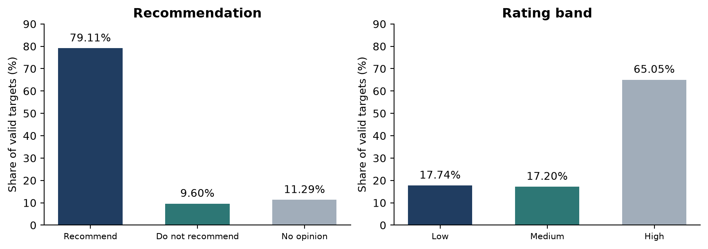
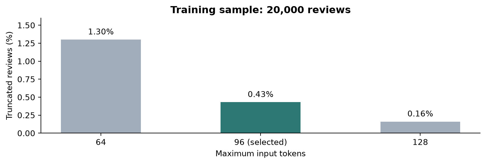
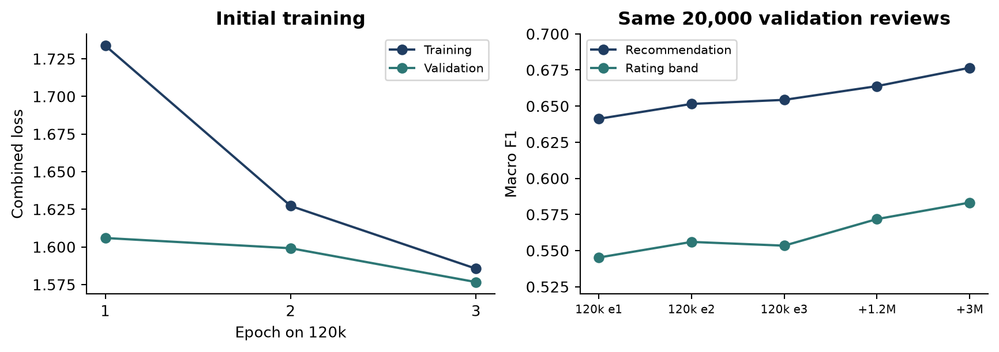
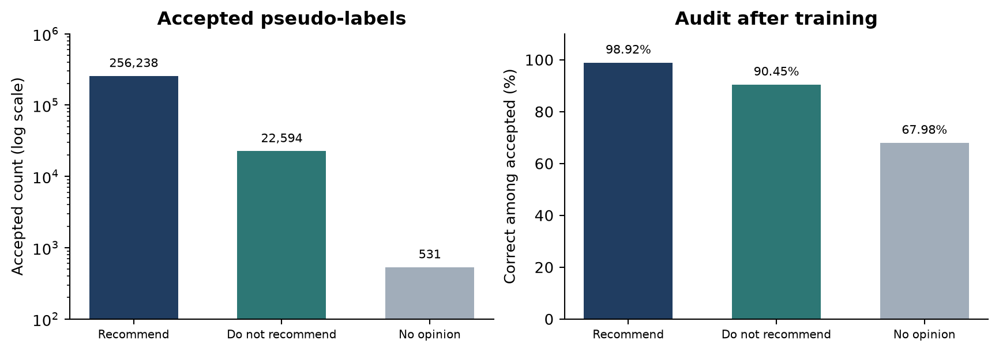

> # گزارش نهایی پروژهٔ ۳: تحلیل هوشمند نظرات دیجی‌کالا
>
> طبقه‌بندی پیشنهاد خرید و پیش‌بینی بازهٔ امتیاز با یادگیری انتقالی و نیمه‌نظارتی
>
> عماد نعمتی
>
> پروژهٔ یادگیری ماشین و پردازش زبان طبیعی — آبان ۱۴۰۵
>
> ## چکیده
>
> در این پروژه بررسی کردم که فقط با خواندن متن یک نظر فارسی، تا چه اندازه می‌توان وضعیت پیشنهاد خرید و بازهٔ امتیاز ثبت‌شدهٔ کاربر را پیش‌بینی کرد. فایل نظرات ۶٬۱۵۶٬۲۸۹ رکورد داشت و بررسی کیفیت داده را روی کل آن انجام دادم. پس از حذف متن‌های گمشده و رسیدگی به شناسه‌های تکراری، ۶٬۱۵۲٬۱۸۲ نظر باقی ماند. داده‌ها را بر اساس شناسهٔ محصول به آموزش، اعتبارسنجی و آزمون تقسیم کردم تا نظرهای یک محصول در چند مجموعه پخش نشوند.
>
> ابتدا دو طبقه‌بند رگرسیون لجستیک با ویژگی‌های `TF-IDF` ساختم. سپس `ParsBERT` را با یک انکودر مشترک و دو سر خروجی تنظیم کردم. به علت محدودیت سیستم شخصی، آموزش عمیق را روی `GPU` نوع Tesla T4 در Google `Colab` انجام دادم. آموزش را از ۱۲۰ هزار نظر شروع کردم، یک دور روی ۱٫۲ میلیون نظر ادامه دادم و در مرحلهٔ آخر یک دور دیگر روی ۳ میلیون نظر اجرا کردم. مدل نهایی روی آزمون، برای پیشنهاد خرید به `Macro F1` برابر ۰٫۶۸۲۱ و برای بازهٔ امتیاز به ۰٫۵۸۳۲ رسید. این دو مقدار برای مدل پایه به‌ترتیب ۰٫۵۴۴۵ و ۰٫۵۴۸۰ بودند.
>
> برای آزمایش نیمه‌نظارتی، مطابق پروتکل پروژه برچسب پیشنهاد خرید ۲۰٪ از داده‌های برچسب‌دار آموزش را پنهان کردم. از ۷۳۶٬۵۴۰ نظر این بخش، مدل والد ۱٫۲ میلیونی برای ۲۷۹٬۳۶۳ نظر پیش‌بینی با احتمال حداقل ۰٫۹۰ داشت. اضافه کردن این داده‌ها، `Macro F1` آزمون را در دو هدف به اندازهٔ ۰٫۰۰۱۶ و ۰٫۰۰۰۷ بهتر کرد، اما دقت بازهٔ امتیاز کاهش یافت و خطای ترتیبی بیشتر شد. بنابراین نتیجهٔ این آزمایش، بهبود کوچک و یکدستی نبود. در پایان ۳۲ نمونهٔ خطا را بررسی کردم و مدل منتخب را همراه با توکنایزر، نرمال‌ساز و اسکریپت پیش‌بینی آفلاین ذخیره کردم. مهم‌ترین محدودیت ارزیابی، تکرار عین متن در ۳۳٫۷۱٪ از ردیف‌های آزمون نسبت به زیرمجموعهٔ آموزش سه‌میلیونی است.
>
> # ۱ مقدمه
>
> ## ۱-۱ بیان مسئله
>
> نظرهای کاربران معمولاً فقط یک جملهٔ روشن دربارهٔ خوب یا بد بودن کالا نیستند. ممکن است کاربر کیفیت را پسندیده باشد اما از قیمت ناراضی باشد، دربارهٔ خرید مردد باشد یا با کنایه نظر بدهد. گاهی هم متن با امتیاز یا گزینهٔ پیشنهاد خریدی که کاربر ثبت کرده هم‌خوان نیست. مسئلهٔ من در این پروژه یادگیری رابطهٔ متن با همین برچسب‌های ثبت‌شده بود.
>
> ورودی هر دو مدل فقط ستون body است. خروجی اول سه حالت «پیشنهاد می‌کنم»، «پیشنهاد نمی‌کنم» و «نظری ندارم» دارد. خروجی دوم، امتیاز عددی را در یکی از سه بازهٔ پایین، متوسط و بالا قرار می‌دهد. «نظری ندارم» یک کلاس معتبر است و با خالی بودن برچسب تفاوت دارد. همچنین خروجی دوم تخمین امتیاز دقیق یا تعداد ستاره نیست؛ مسئله را به صورت طبقه‌بندی سه‌کلاسه حل کردم.
>
> این سیستم از سابقهٔ خرید یا ویژگی‌های شخصی استفاده نمی‌کند و پیشنهادگر شخصی‌سازی‌شدهٔ کالا نیست. هدف، تحلیل متن نظر و پیش‌بینی دو متغیر ثبت‌شده برای همان نظر است.
>
> ## ۱-۲ داده
>
> دادهٔ عمومی پروژه از مخزن RadeAI/Digikala_comments_products در Hugging Face دریافت شد [۱]. فایل استفاده‌شده، digikala-comments.csv، دقیقاً ۱٬۲۷۸٬۵۲۶٬۹۵۹ بایت حجم، ۱۵ ستون و ۶٬۱۵۶٬۲۸۹ رکورد قابل‌خواندن داشت. تعداد رکوردها را با خواندن ساختار CSV به دست آوردم؛ شمارش خط‌های فایل مناسب نبود، چون برخی نظرها چندخطی هستند. در این فایل ۳۳۱٬۵۹۹ محصول یکتا و ۲۹٬۲۱۳ کد فروشندهٔ غیرگمشده وجود داشت.
>
> عنوان نظر، تاریخ، شناسهٔ محصول، مشخصات فروشنده، لایک، دیسلایک، مزایا و معایب در داده موجود بودند، اما وارد مدل نشدند. شناسهٔ محصول فقط برای تقسیم گروهی و ستون rate فقط برای ساخت هدف بازهٔ امتیاز استفاده شد. با این محدودیت، کیفیت پیش‌بینی واقعاً به اطلاعات موجود در متن body وابسته است.
>
> ## ۱-۳ هدف‌ها و دامنهٔ این گزارش
>
> هدف اولم این بود که پیش از آموزش، خطاها و سوگیری‌های داده را مشخص کنم و برای پاک‌سازی آن قاعدهٔ قابل‌تکرار داشته باشم. هدف دوم، ساخت یک مدل پایهٔ ساده و مقایسهٔ آن با مدل فارسی ازپیش‌آموزش‌دیده بود. هدف سوم، اجرای یک آزمایش نیمه‌نظارتی با آستانهٔ ثابت و سنجش اثر آن روی دادهٔ آزمون بود.
>
> دامنهٔ اجرا، فاز اول پروژه است: تحلیل داده، آماده‌سازی، دو مدل، آزمایش نیمه‌نظارتی، تحلیل خطا و پیش‌بینی آفلاین. بخش اختیاری `FastAPI` و `Docker` و همچنین رگرسیون امتیاز دقیق در این نسخه پیاده‌سازی نشده‌اند. در گزارش، آزمایش‌های اجراشده را از پیشنهادهای آینده جدا کرده‌ام.
>
> ## ۱-۴ ساختار گزارش
>
> ابتدا محیط اجرا و معیارها را توضیح می‌دهم. بعد، یافته‌های تحلیل داده را به تصمیم‌های پاک‌سازی، نرمال‌سازی و تقسیم ارتباط می‌دهم. فصل‌های ششم تا هشتم به مدل پایه، تنظیم ترنسفورمر و آزمایش نیمه‌نظارتی اختصاص دارند. در فصل نهم خطاها را با نمونهٔ واقعی بررسی می‌کنم. فصل‌های پایانی، اجرای آفلاین، محدودیت‌های نتیجه و پیشنهادهای ادامهٔ کار را پوشش می‌دهند. مشکلات اجرایی، راهنمای بازتولید و معیارهای کامل هر کلاس نیز در پیوست‌ها آمده‌اند.
>
> # ۲ محیط اجرا و روش کار
>
> ## ۲-۱ سخت‌افزار و نرم‌افزار
>
> سیستم شخصی من برای آموزش ترنسفورمر روی چند میلیون نظر مناسب نبود. تحلیل داده و مدل پایه را در محیط `CPU` و آموزش عمیق را در `Colab` با Tesla T4 انجام دادم. حافظهٔ `GPU` مشاهده‌شده حدود ۱۴٫۶ گیبی‌بایت و RAM محیط حدود ۱۲٫۷ گیگابایت بود. به جای تلاش برای آموزش کل مدل روی سیستم شخصی، ابتدا سرعت و مصرف حافظه را در یک اجرای کوتاه سنجیدم و بعد حجم آموزش را بالا بردم.
>
> | بخش | محیط یا نسخهٔ ثبت‌شده |
> | --- | --- |
> | اجرای نوت‌بوک‌ها | Google `Colab` |
> | `GPU` آموزش عمیق | Tesla T4، حدود ۱۴٫۶ GiB |
> | `Python` بستهٔ نهایی | 3.13.16 |
> | PyTorch آموزش | 2.14.1+cu130 |
> | Transformers | 5.22.1 |
> | scikit-learn مدل پایه | 1.6.1 |
> | pandas | 2.2.3 |
> | DuckDB | 1.3.2 |
>
> نسخه‌های بسته‌ها در requirements.txt و تنظیمات استنتاج در models/inference_config.json ثبت شده‌اند. برای فایل حجیم از خواندن مرحله‌ای و DuckDB استفاده کردم تا لازم نباشد همهٔ ستون‌های متنی را هم‌زمان به شکل DataFrame در حافظه نگه دارم.
>
> ## ۲-۲ بازتولیدپذیری
>
> تقسیم محصولی، انتخاب زیرمجموعه‌های آموزش و پنهان کردن برچسب‌ها با قواعد هش ثابت انجام شد. بنابراین انتخاب ردیف‌ها به ترتیب اولیهٔ CSV وابسته نیست. بذر تقسیم و نمونه‌گیری اصلی ۲۰۲۶ است و قاعدهٔ ماسک کردن، نام ثابت digikala-semi-supervised-v1 دارد. جزئیات این قواعد و هش فایل منبع در split_manifest.json ذخیره شده‌اند.
>
> مدل پیش‌آموزش‌دیده نیز با revision مشخص a04aa40c97bcdde570ae11986a534542c2995a62 بارگذاری شد. بهترین وزن‌ها، ترتیب کلاس‌ها، طول ورودی، نرمال‌سازی و توکنایزر در بستهٔ نهایی موجودند. این موارد برای اجرای دوبارهٔ پیش‌بینی ضروری‌اند؛ صرفاً نگه داشتن فایل وزن کافی نیست.
>
> نوت‌بوک‌های تحویلی خروجی اجراهای تعاملی را دارند. اجرای پیش‌بینی مستقل با فایل‌های محلی و غیرفعال بودن دانلود تأیید شد. در این مرحله، اجرای پیوستهٔ هر چهار نوت‌بوک از ابتدا در یک محیط تازه بررسی نشده است. همچنین تعیین بذر به معنی تضمین برابری بیت‌به‌بیت همهٔ اجراهای `GPU` در محیط‌های متفاوت نیست.
>
> ## ۲-۳ معیارهای ارزیابی
>
> چون کلاس‌ها نامتوازن بودند، معیار اصلی را `Macro F1` قرار دادم. ابتدا F1 برای هر کلاس جداگانه محاسبه می‌شود و سپس میانگین سادهٔ سه کلاس گرفته می‌شود. در نتیجه، کلاس کوچک «نظری ندارم» به اندازهٔ کلاس بزرگ «پیشنهاد می‌کنم» در این نمره سهم دارد. `Accuracy` را هم گزارش کردم، اما آن را به تنهایی برای قضاوت کافی ندانستم.
>
> `Precision` نشان می‌دهد از پیش‌بینی‌های یک کلاس چه سهمی درست بوده‌اند. `Recall` نشان می‌دهد چه سهمی از نمونه‌های واقعی همان کلاس پیدا شده‌اند. `Balanced Accuracy` میانگین `Recall` کلاس‌هاست و در این مسئله با Macro `Recall` برابر است. ماتریس درهم‌ریختگی نیز مشخص می‌کند خطاها بین کدام کلاس‌ها رخ داده‌اند [۳].
>
> برای بازهٔ امتیاز، کدهای پایین=۰، متوسط=۱ و بالا=۲ را در نظر گرفتم. میانگین قدرمطلق فاصلهٔ کد واقعی و پیش‌بینی‌شده را نیز حساب کردم. خطای پایین به بالا فاصلهٔ دو دارد، ولی پایین به متوسط فاصلهٔ یک. این معیار بر حسب فاصلهٔ بازه‌هاست، نه واحد امتیاز اصلی صفر تا پنج. هدف دارای برچسب گمشده در محاسبهٔ معیار همان هدف کنار گذاشته می‌شود.
>
> # ۳ بررسی و تمیزسازی داده
>
> ## ۳-۱ مقدار گمشده
>
> در بررسی اول، فقط رشتهٔ خالی را شمرده بودم و در بسیاری از ستون‌ها مقدار گمشده دیده نمی‌شد. بررسی دقیق‌تر نشان داد که داده برای مقدار ناموجود از رشتهٔ nan هم استفاده کرده است. بنابراین هر دو حالت رشتهٔ خالی و nan را در گزارش کیفیت حساب کردم. این اصلاح به‌خصوص برای عنوان، مزایا، معایب و برچسب پیشنهاد خرید مهم بود.
>
> | ستون | تعداد گمشده | درصد از کل |
> | --- | --- | --- |
> | id | ۰ | ۰٫۰۰٪ |
> | title | ۲٬۸۶۶٬۴۱۵ | ۴۶٫۵۶٪ |
> | body | ۶۳۷ | ۰٫۰۱٪ |
> | created_at | ۰ | ۰٫۰۰٪ |
> | rate | ۰ | ۰٫۰۰٪ |
> | recommendation_status | ۸۹۴٬۴۲۶ | ۱۴٫۵۳٪ |
> | is_buyer | ۰ | ۰٫۰۰٪ |
> | product_id | ۰ | ۰٫۰۰٪ |
> | advantages | ۵٬۴۴۸٬۰۸۴ | ۸۸٫۵۰٪ |
> | disadvantages | ۵٬۷۴۴٬۰۱۷ | ۹۳٫۳۰٪ |
> | likes | ۰ | ۰٫۰۰٪ |
> | dislikes | ۰ | ۰٫۰۰٪ |
> | seller_title | ۳۰۲٬۱۸۱ | ۴٫۹۱٪ |
> | seller_code | ۳۰۲٬۱۸۱ | ۴٫۹۱٪ |
> | true_to_size_rate | ۶٬۰۶۵٬۵۱۶ | ۹۸٫۵۳٪ |
>
> از ۲٬۸۶۶٬۴۱۵ عنوان گمشده، ۱٬۳۵۳ مورد رشتهٔ خالی و بقیه nan بودند. متن body در ۶۳۷ رکورد nan بود. نبودن متن ورودی را نمی‌توان با داشتن امتیاز جبران کرد، پس این ردیف‌ها وارد مدل نشدند. در مقابل، نبودن فقط یکی از دو هدف باعث حذف کامل نظر نشد؛ آن نظر برای هدف معتبر دیگر قابل‌استفاده بود.
>
> ## ۳-۲ بازهٔ امتیاز و شناسهٔ تکراری
>
> هیچ رکورد با تعداد ستون نامعتبر و هیچ مقدار غیرخالیِ غیرقابل‌تبدیل به عدد در rate دیده نشد. با این حال، یک مقدار ۲۵۰۰ وجود داشت که خارج از دامنهٔ صفر تا پنج بود. این مقدار را به پنج تبدیل نکردم؛ هدف بازهٔ امتیاز آن نامعتبر در نظر گرفته شد.
>
> | شاخص امتیاز | همهٔ مقادیر عددی | فقط مقادیر معتبر |
> | --- | --- | --- |
> | تعداد | ۶٬۱۵۶٬۲۸۹ | ۶٬۱۵۶٬۲۸۸ |
> | میانگین | ۳٫۶۴۸۳ | ۳٫۶۴۷۹ |
> | انحراف معیار | ۱٫۸۶۱۹ | ۱٫۵۶۶۶ |
> | کمینه | ۰ | ۰ |
> | بیشینه | ۲۵۰۰ | ۵ |
> | میانه | ۴ | ۴ |
> | تعداد مقدار یکتا | ۱۷۸ | ۱۷۷ |
> | درصد مقادیر اعشاری | ۳٫۷۱٪ | ۳٫۷۱٪ |
>
> یک مقدار پرت روی میانگین اثر کمی داشت، اما انحراف معیار را از ۱٫۵۶۶۶ به ۱٫۸۶۱۹ رسانده بود. این مثال نشان داد که فقط نگاه کردن به میانگین برای تأیید کیفیت کافی نیست. صدک‌های ۵، ۲۵، ۵۰ و ۷۵ امتیاز معتبر به‌ترتیب صفر، سه، چهار و پنج بودند. صدک‌های ۹۰، ۹۵ و ۹۹ نیز پنج بودند.
>
> ۳٬۲۲۶ شناسهٔ تکرارشده با ۳٬۲۲۹ ردیف اضافه وجود داشت. در ۲٬۹۱۱ شناسه، فیلدهای موردنیاز مدل یکسان بودند؛ در ۳۱۵ شناسه تفاوت وجود داشت. حذف اولین یا آخرین ردیف بدون بررسی، می‌توانست برچسب متفاوتی را به شکل تصادفی نگه دارد. بنابراین ابتدا اختلاف‌ها را تفکیک کردم.
>
> | اختلاف در گروه‌های شناسهٔ تکراری | تعداد شناسه |
> | --- | --- |
> | چند متن غیرگمشدهٔ متفاوت | ۲۴۱ |
> | چند کلاس معتبر پیشنهاد خرید | ۴۳ |
> | ترکیب برچسب پیشنهاد خرید معتبر و گمشده | ۵۸ |
> | چند مقدار عددی متفاوت برای rate | ۷۹ |
> | نرخ متفاوت ولی در یک بازهٔ معتبر | ۳۱ |
> | چند بازهٔ امتیاز متعارض | ۴۸ |
> | حضور در چند محصول | ۰ |
>
> این ردیف‌ها دسته‌های جدا از هم نیستند و نباید جمع زده شوند. همهٔ شناسه‌هایی را که چند متن متفاوت داشتند کنار گذاشتم. برای بقیه، یک نظر نگه داشتم؛ اگر برچسب‌های معتبر یک هدف اختلاف داشتند، فقط همان هدف را ماسک کردم. برچسب گمشده در کنار یک برچسب معتبر، به‌خودی‌خود تعارض نبود. تفاوت امتیازهای عددی که به یک بازه می‌رسیدند هم برای مسئلهٔ فعلی تعارض محسوب نشد.
>
> پس از حذف گروه‌های چندمتنی، در ادغام باقی‌مانده‌ها ۱۶ هدف پیشنهاد خرید و ۱۵ هدف بازهٔ امتیاز به علت تعارض ماسک شدند. تفاوت این اعداد با ۴۳ و ۴۸ از آن‌جاست که بخشی از تعارض‌ها در گروه‌های چندمتنی قرار داشتند و آن گروه‌ها قبلاً حذف شده بودند.
>
> ## ۳-۳ رفتار امتیاز صفر
>
> وجود امتیاز صفر مسئلهٔ قابل‌توجهی بود. هم صدک پنجم امتیاز صفر بود و هم در تحلیل نمونه‌ها متن‌های مثبتی مثل «چسب دار بودنش خیلی خوب بود» با امتیاز صفر دیده شد. از متن به تنهایی نمی‌توانم تعیین کنم که این صفر همیشه نارضایتی واقعی است، مقدار پیش‌فرض سامانه است یا اشتباه ثبت شده است.
>
> طبق تعریف پروژه، صفر مقدار معتبر و در بازهٔ پایین است. بدون مدرک دربارهٔ معنای آن، صفرها را حذف یا به مقدار دیگری تبدیل نکردم. پیامد این تصمیم آن است که مدل گاهی باید برای متن ظاهراً مثبت، برچسب پایین را یاد بگیرد. این تعارض احتمالی در تفسیر خطاهای امتیاز مطرح می‌شود، اما دلیل کافی برای درست دانستن تمام پیش‌بینی‌های مخالف برچسب نیست.
>
> ## ۳-۴ الگوی گمشدگی برچسب توصیه
>
> | وضعیت خریدار | کل نظر | توصیهٔ گمشده | درصد گمشدگی |
> | --- | --- | --- | --- |
> | غیرخریدار | ۳۰۲٬۱۸۱ | ۳۰۲٬۱۸۱ | ۱۰۰٫۰۰٪ |
> | خریدار | ۵٬۸۵۴٬۱۰۸ | ۵۹۲٬۲۴۵ | ۱۰٫۱۲٪ |
>
> این اختلاف با فرض گمشدگی کاملاً تصادفی سازگار نیست. در همین داده، هر نظر غیرخریدار فاقد برچسب پیشنهاد خرید است. میانگین امتیاز معتبر نیز در گروه بدون توصیه ۴٫۰۴۱ بود، در حالی که برای «نظری ندارم» ۲٫۹۲۳، برای «پیشنهاد نمی‌کنم» ۱٫۴۴۸ و برای «پیشنهاد می‌کنم» ۳٫۹۳۴ بود. پس دادهٔ بدون توصیه، صرفاً نسخه‌ای تصادفی از دادهٔ برچسب‌دار نیست.
>
> از نظر بازهٔ امتیاز، نرخ گمشدگی توصیه در گروه بالا ۱۷٫۰۴٪، در پایین ۹٫۲۲٪ و در متوسط ۱۰٫۵۰٪ بود. برای محصول‌های تک‌نظر، ۲۰٫۳۰٪ از توصیه‌ها گمشده بود؛ این مقدار برای محصول‌های دارای بیش از صد نظر به ۱۲٫۸۹٪ می‌رسید. با محدود کردن بررسی به خریداران، اختلاف این دو گروه به ۱۰٫۴۵٪ و ۹٫۶۱٪ کاهش یافت. بنابراین بخشی از الگوی مشاهده‌شده با ترکیب خریدار و غیرخریدار ارتباط دارد؛ از این جدول رابطهٔ علّی نتیجه نگرفتم.
>
> به همین دلیل، آزمایش اصلی نیمه‌نظارتی را روی برچسب‌های عمداً پنهان‌شده اجرا کردم. این آزمایش مرجع قابل‌اندازه‌گیری دارد، ولی نتیجه‌اش مستقیماً کیفیت برچسب‌زنیِ نظرهای طبیعیِ بدون برچسب را نشان نمی‌دهد.
>
> ## ۳-۵ توزیع هدف‌ها
>
> | کلاس پیشنهاد خرید | تعداد پیش از پاک‌سازی | سهم از برچسب‌های معتبر |
> | --- | --- | --- |
> | recommended | ۴٬۱۶۲٬۸۳۹ | ۷۹٫۱۱٪ |
> | not_recommended | ۵۰۴٬۹۰۳ | ۹٫۶۰٪ |
> | no_idea | ۵۹۴٬۱۲۱ | ۱۱٫۲۹٪ |
>
> | بازهٔ امتیاز | تعریف ثابت | تعداد معتبر | سهم |
> | --- | --- | --- | --- |
> | پایین | صفر تا کمتر از ۲٫۵ | ۱٬۰۹۲٬۳۲۹ | ۱۷٫۷۴٪ |
> | متوسط | ۲٫۵ تا کمتر از ۴ | ۱٬۰۵۹٬۰۵۴ | ۱۷٫۲۰٪ |
> | بالا | ۴ تا ۵، شامل دو مرز | ۴٬۰۰۴٬۹۰۵ | ۶۵٫۰۵٪ |
>
> بزرگ بودن کلاس مثبت باعث می‌شود `Accuracy` بالا، لزوماً به معنی شناخت خوب کلاس‌های کوچک نباشد. از وزن‌دهی معکوس فراوانی کلاس‌ها در آموزش استفاده کردم و معیار هر کلاس را جدا گزارش دادم. توازن کلاس‌ها را با حذف گستردهٔ نظرهای مثبت ایجاد نکردم، چون این کار بخش بزرگی از دادهٔ واقعی را کنار می‌گذاشت.
>

>
> ## ۳-۶ طول متن
>
> | شاخص | تعداد نویسه | تعداد واژه |
> | --- | --- | --- |
> | میانگین | ۴۸٫۲۱ | ۱۰٫۰۹ |
> | میانه | ۲۹ | ۶ |
> | صدک ۹۰ | ۱۰۶ | ۲۲ |
> | صدک ۹۵ | ۱۵۲ | ۳۲ |
> | صدک ۹۹ | ۲۹۶ | ۶۲ |
> | بیشینه | ۴٬۰۰۰ | ۹۰۸ |
>
> این آمار روی ۶٬۱۵۵٬۶۵۲ متن غیرگمشده محاسبه شد. ۱٬۶۷۵٬۵۲۶ متن، یعنی ۲۷٫۲۲٪، حداکثر سه واژه داشتند. فقط ۱۶٬۰۱۲ متن، معادل ۰٫۲۶٪، دست‌کم صد واژه داشتند. بنابراین بخش بزرگی از مسئله به جمله‌های کوتاه وابسته است و اطلاعات زبانی هر نمونه ممکن است بسیار کم باشد.
>
> میانه و صدک ۹۵ تعداد واژه در نظرهای «پیشنهاد می‌کنم» ۶ و ۲۸، در «نظری ندارم» ۸ و ۳۸ و در «پیشنهاد نمی‌کنم» ۱۰ و ۴۵ بود. نظرهای منفی معمولاً توضیح بیشتری داشتند. در نتیجه، انتخاب طول ورودی خیلی کوتاه می‌توانست به کلاس منفی بیشتر آسیب بزند. با این حال، تعداد واژه معادل تعداد توکن مدل نیست؛ تصمیم نهایی را بعد از اجرای توکنایزر گرفتم.
>
> ## ۳-۷ تمرکز محصول‌ها
>
> | شاخص تعداد نظر برای هر محصول | مقدار |
> | --- | --- |
> | میانگین | ۱۸٫۵۷ |
> | میانه | ۴ |
> | صدک ۹۰ | ۴۶ |
> | صدک ۹۵ | ۱۱۰ |
> | صدک ۹۹ | ۲۰۰ |
> | بیشینه | ۴۰۰ |
>
> یک درصد از محصول‌ها ۱۰٫۸۵٪ از کل نظرها را داشتند. ۹۱٬۹۴۴ محصول فقط یک نظر داشتند، در حالی که ۱۷٬۹۰۴ محصولِ دارای بیش از صد نظر، روی هم ۳٬۰۹۸٬۳۹۸ نظر داشتند. در تقسیم تصادفی ردیفی، نظرهای محصول‌های پرنظر به احتمال زیاد در آموزش و آزمون مشترک می‌شدند. تقسیم محصولی را برای کنترل همین مسئله انتخاب کردم. این تقسیم مانع اشتراک شناسهٔ محصول می‌شود، ولی به تنهایی تکرار متن را از بین نمی‌برد.
>
> ## ۳-۸ متن تکراری و برچسب متناقض
>
> ۱۹۷٬۷۴۴ متن متفاوت بیش از یک بار تکرار شده بودند و در مجموع ۲٬۲۱۷٬۱۳۹ ردیف را شامل می‌شدند. نسبت به نگه داشتن یک ردیف برای هر متن، ۲٬۰۱۹٬۳۹۵ ردیف اضافه وجود داشت. ۱۹۵٬۲۱۰ متن تکراری در چند محصول دیده شدند. در ۳۱٬۹۴۱ متن، کلاس پیشنهاد خرید و در ۸۲٬۶۱۹ متن، بازهٔ امتیاز میان تکرارها متفاوت بود.
>
> شناسهٔ تکراری را با متن تکراری یکسان ندانستم. دو کاربر می‌توانند برای دو کالای متفاوت جملهٔ کوتاه یکسانی مثل «خوب بود» بنویسند. حذف همهٔ این موارد، توزیع واقعی متن‌های کوتاه را تغییر می‌داد. بنابراین پاک‌سازی اصلی را در سطح شناسه انجام دادم و هم‌پوشانی متن را جدا اندازه گرفتم. در فصل محدودیت‌ها توضیح می‌دهم که این انتخاب چه اثری بر اعتبار ارزیابی دارد.
>
> ## ۳-۹ جمع‌بندی یافته‌ها و تصمیم‌ها
>
> | یافتهٔ داده | تصمیم در اجرا |
> | --- | --- |
> | عدم توازن هر دو هدف | وزن‌دهی کلاس‌ها و گزارش `Macro F1` |
> | گمشدگی ساختاری توصیه | آزمایش اصلی با ماسک مصنوعی ثابت |
> | کوتاه بودن بیشتر متن‌ها | اندازه‌گیری توکن پیش از انتخاب طول ورودی |
> | تمرکز نظرها روی بعضی محصول‌ها | تقسیم گروهی بر اساس product_id |
> | اختلاف در شناسه‌های تکراری | بررسی تعارض، حذف گروه چندمتنی و ماسک هدف متعارض |
> | تکرار جمله‌های کوتاه | اندازه‌گیری هم‌پوشانی و گزارش محدودیت |
> | صفرهای ظاهراً ناسازگار با متن | حفظ تعریف هدف و پرهیز از اصلاح حدسی |
>
> خروجی پاک‌سازی ۶٬۱۵۲٬۱۸۲ نظر با شناسهٔ یکتا و متن موجود بود. ۵٬۲۵۸٬۲۵۷ نظر توصیهٔ معتبر و ۶٬۱۵۲٬۱۶۶ نظر بازهٔ امتیاز معتبر داشتند. ۸۹۳٬۹۰۹ نظر به‌طور طبیعی بدون برچسب توصیه بودند و فقط پنج نظر هیچ‌یک از دو هدف معتبر را نداشتند. تعداد خام و پاک‌شده را در گزارش جدا نگه داشتم تا تفاوت آن‌ها با خطای شمارش اشتباه نشود.
>
> # ۴ پیش‌پردازش متن فارسی
>
> ## ۴-۱ اندازه‌گیری و تصمیم
>
> پیش‌پردازش را محدود نگه داشتم تا نشانه‌های احساس و نفی از بین نروند. «ي» و «ك» عربی به «ی» و «ک» فارسی تبدیل شدند، فاصله‌های اضافی یکدست شدند و نویسه‌های کنترلی انتخاب‌شده حذف شدند. نیم‌فاصلهٔ داخل واژه حفظ شد و نیم‌فاصلهٔ تکراری به یکی تبدیل شد. موجودیت‌های متنی HTML باز شدند و تگ‌ها کنار رفتند. نشانی اینترنتی نیز با [URL] جایگزین شد.
>
> اعداد، شکلک‌ها و کلمه‌های نفی را حذف نکردم. مثلاً حذف «نیست» از «کیفیت کالا خوب نیست» معنی نظر را عوض می‌کند. ریشه‌یابی و حذف توقف‌واژه هم در اجرای اصلی انجام نشد. برای چنین تغییرهایی به مقایسهٔ کنترل‌شده نیاز بود و نمی‌خواستم مفید بودن آن‌ها را از پیش فرض کنم.
>
> همین تابع normalize_text در آموزش مدل پایه، ورودی ترنسفورمر و پیش‌بینی نهایی استفاده می‌شود. این یکسانی مهم است؛ اگر متن در زمان پیش‌بینی با قاعده‌ای متفاوت از آموزش آماده شود، ورودی واقعی مدل تغییر می‌کند. نرمال‌ساز آماری از داده یاد نمی‌گیرد و صرفاً قواعد مشخصی را اجرا می‌کند.
>
> ## ۴-۲ آزمون پایداری
>
> چهار آزمون مشخص برای نرمال‌ساز نوشتم و هر چهار مورد گذشتند. آزمون‌ها تبدیل حروف عربی، حفظ نفی و نیم‌فاصله، باز کردن تگ رمزگذاری‌شده و جایگزینی URL را پوشش می‌دهند. برای نمونه، جملهٔ «كيفيت كالا خوب نيست» به «کیفیت کالا خوب نیست» تبدیل شد. عبارت «نمی‌خرم ۱۲۳» نیز با همان نفی، عدد و نیم‌فاصله باقی ماند.
>
> این چهار آزمون، صحت همهٔ حالت‌های ممکن فارسی را اثبات نمی‌کنند، اما جلوی تغییر ناخواستهٔ چند رفتار ضروری را می‌گیرند. نرمال‌ساز عمداً غلط املایی را تصحیح نمی‌کند؛ بنابراین تفاوت‌هایی مثل «فک» و «فکر» هنوز در متن وجود دارند و باید توسط نمایش مدل مدیریت شوند.
>
> # ۵ تقسیم داده و ماسک کردن برچسب‌ها
>
> ## ۵-۱ تقسیم بر اساس محصول
>
> برای هر product_id یک هش از بذر ۲۰۲۶ و شناسه ساختم و آن را به یک عدد بین صفر تا ۹۹۹۹ تبدیل کردم. بازهٔ صفر تا ۶۹۹۹ به آموزش، ۷۰۰۰ تا ۸۴۹۹ به اعتبارسنجی و ۸۵۰۰ تا ۹۹۹۹ به آزمون اختصاص یافت. تمام نظرهای یک محصول با هم جابه‌جا شدند و شناسهٔ محصول مشترک بین سه بخش وجود ندارد.
>
> | مجموعه | محصول یکتا | نظر | سهم نظرها |
> | --- | --- | --- | --- |
> | آموزش | ۲۳۱٬۸۱۹ | ۴٬۳۰۷٬۳۱۰ | ۷۰٫۰۱٪ |
> | اعتبارسنجی | ۵۰٬۰۳۱ | ۹۲۵٬۱۹۷ | ۱۵٫۰۴٪ |
> | آزمون | ۴۹٬۷۴۲ | ۹۱۹٬۶۷۵ | ۱۴٫۹۵٪ |
>
> این روش در سطح محصول تقریباً نسبت ۷۰/۱۵/۱۵ می‌دهد و لزوماً تعداد ردیف‌ها را دقیقاً به همین نسبت تقسیم نمی‌کند. به همین دلیل، نمایندگی هر دو هدف را بعد از تقسیم بررسی کردم. سهم «پیشنهاد می‌کنم» در آموزش، اعتبارسنجی و آزمون به‌ترتیب ۷۹٫۰۸٪، ۷۹٫۰۸٪ و ۷۹٫۳۱٪ بود. سهم بازهٔ بالا نیز ۶۴٫۹۹٪، ۶۵٫۰۳٪ و ۶۵٫۳۷٪ بود. اختلاف مشاهده‌شده کوچک بود و برای تغییر دادن تقسیم یا جست‌وجوی بذر بهتر، از نتیجهٔ آزمون استفاده نکردم.
>
> پیش از ماسک کردن، ۳۲۲٬۵۸۴ ردیف اعتبارسنجی و ۳۲۰٬۸۶۴ ردیف آزمون متنی عیناً موجود در کل آموزش داشتند. برای زیرمجموعهٔ نهایی سه‌میلیونی، عدد دقیق هم‌پوشانی آزمون ۳۱۰٬۰۴۱ ردیف، معادل ۳۳٫۷۱٪ شد. پس جداسازی محصول انجام شده، اما متن کاملاً جدید برای همهٔ نظرهای آزمون تضمین نشده است.
>
> ## ۵-۲ ماسک کردن برای آزمایش نیمه‌نظارتی
>
> در هر کلاسِ دارای توصیهٔ معتبر در آموزش، ردیف‌ها با هش ثابت مرتب شدند و ۲۰٪ اول با گرد کردن رو به پایین انتخاب شدند. برچسب واقعی این ردیف‌ها در ورودی آزمایش نیمه‌نظارتی قرار نگرفت. فایل مخزن مصنوعی فقط id و body دارد؛ امتیاز واقعی آن‌ها نیز در این فایل قرار داده نشد.
>
> | کلاس اصلی توصیه | برچسب‌دار در آموزش پیش از ماسک | منتقل‌شده به مخزن مصنوعی |
> | --- | --- | --- |
> | no_idea | ۴۱۶٬۳۱۸ | ۸۳٬۲۶۳ |
> | not_recommended | ۳۵۴٬۰۳۴ | ۷۰٬۸۰۶ |
> | recommended | ۲٬۹۱۲٬۳۵۹ | ۵۸۲٬۴۷۱ |
> | جمع | ۳٬۶۸۲٬۷۱۱ | ۷۳۶٬۵۴۰ |
>
> فایدهٔ این روش آن است که بعداً برای سنجش کیفیت شبه‌برچسب‌ها، پاسخ واقعی قابل‌بازیابی است. این پاسخ‌ها را پس از آموزش مدل نیمه‌نظارتی برای ممیزی استفاده کردم، نه برای انتخاب آستانه یا اصلاح شبه‌برچسب‌ها. آستانهٔ احتمال از ابتدا مطابق صورت پروژه ۰٫۹۰ بود.
>
> ## ۵-۳ فایل‌های استاندارد
>
> | فایل | تعداد ردیف | کاربرد |
> | --- | --- | --- |
> | train_supervised.csv | ۳٬۵۷۰٬۷۶۵ | آموزش با هدف‌های معتبر موجود |
> | train_pseudo_unlabeled.csv | ۷۳۶٬۵۴۰ | مخزن مصنوعی بدون هدف |
> | natural_unlabeled.csv | ۶۲۴٬۵۸۶ | نظرهای آموزشیِ طبیعی بدون توصیه |
> | validation.csv | ۹۲۵٬۱۹۷ | انتخاب و مقایسهٔ مدل |
> | test.csv | ۹۱۹٬۶۷۵ | ارزیابی نهایی |
>
> این پنج تعداد را نباید به عنوان مجموعه‌های کاملاً جدا جمع زد. نظرهای طبیعی بدون توصیه، در صورت داشتن امتیاز معتبر، در train_supervised هم برای سر امتیاز حضور دارند. فایل natural_unlabeled یک نمای جدا از همین وضعیت است و مخزن اصلی شبه‌برچسب‌زنی این پروژه نبود. پنج ردیف آموزشی بدون هیچ هدف معتبر از فایل نظارت‌شده کنار گذاشته شدند.
>
> واژگان `TF-IDF` فقط روی train_supervised برازش شد. وزن کلاس‌های مدل پایه از هدف‌های معتبر همین فایل محاسبه شد. وزن‌های ترنسفورمر از نمونهٔ اولیهٔ ۱۲۰ هزارنفری آموزش به دست آمدند و در ادامه ثابت ماندند. در هیچ‌یک از این محاسبه‌ها از برچسب اعتبارسنجی یا آزمون استفاده نشد.
>
> # ۶ مدل پایه: `TF-IDF` و رگرسیون لجستیک
>
> ## ۶-۱ تنظیمات
>
> ابتدا متن نرمال‌شده را به بردار `TF-IDF` واژه‌ای تبدیل کردم. این بردار، حضور و وزن واژه‌ها را نمایش می‌دهد و مدل خطی از روی همین ویژگی‌ها تصمیم می‌گیرد. دو رگرسیون لجستیک مستقل روی یک واژگان مشترک ساختم؛ یکی برای پیشنهاد خرید و دیگری برای بازهٔ امتیاز.
>
> | تنظیم | مقدار |
> | --- | --- |
> | نوع ویژگی | واژهٔ تکی، بدون bigram |
> | سقف تعداد ویژگی | ۶۰٬۰۰۰ |
> | واژگان نهایی | ۵۵٬۳۶۵ |
> | حداقل فراوانی سند | ۵ |
> | وزن فراوانی | sublinear_tf=True |
> | نوع عدد ماتریس | float32 |
> | حل‌کننده | `SAGA` |
> | وزن کلاس‌ها | balanced |
> | C | 1.0 |
> | tol و max_iter | 0.001 و 60 |
> | بذر | 2026 |
>
> الگوی توکن‌سازی مدل پایه، واژه‌های دارای نیم‌فاصله را حفظ می‌کند. برازش واژگان روی ۳٬۵۷۰٬۷۶۵ متن حدود ۱۷۶٫۴ ثانیه طول کشید و ماتریس تنک ۲۶۴٫۱ مگابی‌بایت حافظه داشت. ۶٬۱۰۵ نظر، یعنی ۰٫۱۷٪، پس از اعمال واژگان هیچ ویژگی غیرصفری نداشتند. در چنین ورودی‌هایی تصمیم مدل بیشتر به عرض از مبدأ وابسته می‌شود.
>
> برای سر توصیه ۲٬۹۴۶٬۱۷۱ هدف و برای سر امتیاز ۳٬۵۷۰٬۷۵۹ هدف معتبر موجود بود. تفاوت تعدادها ناشی از گمشدگی هدف‌هاست، نه استفاده از تقسیم‌های جداگانه.
>
> ## ۶-۲ انتخاب C
>
> در اجرای انجام‌شده، C را برابر ۱ گذاشتم و جست‌وجوی چندمقداری برای آن انجام ندادم. بنابراین مقدار ۱، تنظیم ثبت‌شدهٔ این مدل پایه است و نمی‌توانم آن را بهترین مقدار این داده معرفی کنم. C شدت منظم‌سازی را به صورت معکوس کنترل می‌کند [۴].
>
> هر دو طبقه‌بند پس از ۶۰ تکرار با هشدار همگرایی متوقف شدند. زمان آموزش توصیه ۲۳۲٫۳ ثانیه و زمان آموزش بازهٔ امتیاز ۲۵۸٫۱ ثانیه بود. مدل‌های ذخیره‌شده قابل‌استفاده بودند، اما ضرایب تا آستانهٔ همگرایی مقرر نرسیده بودند. در ادامهٔ پروژه این اجرا را با تکرار بیشتر بازآموزی نکردم. پس مقایسهٔ نهایی با یک مدل پایهٔ همگرا و تنظیم‌شده انجام نشده و این موضوع یکی از محدودیت‌های مقایسه است.
>
> ## ۶-۳ نتایج
>
> | هدف در آزمون | `Accuracy` | `Balanced Accuracy` | `Macro F1` |
> | --- | --- | --- | --- |
> | پیشنهاد خرید | 0.8116 | 0.6279 | 0.5445 |
> | بازهٔ امتیاز | 0.6330 | 0.5685 | 0.5480 |
>
> مدل پایه برای توصیهٔ مثبت F1 برابر ۰٫۹۱۵۱ داشت، اما F1 کلاس «نظری ندارم» فقط ۰٫۱۵۴۵ بود. `Recall` همین کلاس ۰٫۰۹۲۷ بود؛ یعنی از هر صد مورد واقعیِ این کلاس، تقریباً نه مورد را پیدا می‌کرد. به همین علت، `Accuracy` حدود ۸۱٪ تصویر کاملی از عملکرد نمی‌داد. در هدف امتیاز نیز F1 کلاس بالا ۰٫۷۵۸۰ بود، ولی کلاس متوسط به ۰٫۴۰۲۴ رسید.
>
> میانگین خطای ترتیبی مدل پایه ۰٫۴۸۵۱ شد. نتیجهٔ این مدل را به عنوان مرجع ساده و کم‌هزینه نگه داشتم تا مشخص شود استفاده از ترنسفورمر در کدام بخش ارزش بیشتری دارد.
>
> ## ۶-۴ ویژگی‌های برتر
>
> در اسکریپت نهایی، برای هر پیش‌بینی مدل پایه سهم واقعی واژه‌ها در اختلاف امتیاز کلاس برنده و کلاس دوم محاسبه می‌شود. این توضیح، حاصل ضرب مقدار `TF-IDF` هر واژه در اختلاف ضریب دو کلاس است. بنابراین به همان جمله و همان دو کلاس وابسته است و نباید آن را فهرست جهانی مهم‌ترین واژه‌ها نامید.
>
> برای جملهٔ «معمولی بود، هنوز مطمئن نیستم ارزش خرید داشته باشه»، واژه‌های «نیستم»، «معمولی» و «مطمئن» به نفع no_idea سهم داشتند. سهم «نیستم» در فاصلهٔ امتیاز این کلاس با recommended حدود ۲٫۸۱۷ بود. در جملهٔ «بعد از دو روز خراب شد و اصلاً پیشنهاد نمی‌کنم»، «نمی‌کنم» و «اصلا» به نفع not_recommended سهم حدود ۲٫۶۰۱ و ۲٫۲۳۵ داشتند. این مقادیر در offline_demo.json ثبت شده‌اند.
>
> این توضیح برای فهم رفتار مدل خطی مفید است، اما علت تصمیم `ParsBERT` را نشان نمی‌دهد. برای مدل عمیق، روش توضیح واژه‌ای مثل حذف توکن یا انتساب گرادیانی اجرا نکردم.
>
> # ۷ فاین‌تیون ترنسفورمر
>
> ## ۷-۱ انتخاب مدل پیش‌آموزش‌دیده
>
> مدل HooshvareLab/bert-fa-base-uncased از خانوادهٔ `ParsBERT` را انتخاب کردم. این مدل بر پایهٔ BERT برای زبان فارسی پیش‌آموزش دیده و با مجوز Apache-2.0 منتشر شده است [۲]. استفاده از مدل آماده باعث شد به جای آموزش زبان از ابتدا، نمایش زبانی آن را برای دو هدف این پروژه تنظیم کنم.
>
> انکودر برای هر متن یک نمایش مشترک تولید می‌کند. بردار توکن آغازین CLS بعد از dropout وارد دو لایهٔ خطی سه‌کلاسه می‌شود. یک لایه وضعیت پیشنهاد خرید و لایهٔ دیگر بازهٔ امتیاز را پیش‌بینی می‌کند. مدل را با دو خروجی ساختم، چون هر دو هدف از متن یکسانی می‌آیند و می‌توانند از نمایش مشترک استفاده کنند.
>
> برای کنترل هزینه، تمام بلوک‌های انکودر به جز بلوک آخر را فریز کردم. بلوک آخر و دو سر خروجی آموزش‌پذیر بودند. از ۱۶۲٬۲۵۵٬۳۶۶ پارامتر، ۷٬۰۹۲٬۴۸۶ پارامتر، یعنی حدود ۴٫۳۷٪، تغییر می‌کردند. این کار هزینهٔ به‌روزرسانی و حافظهٔ آموزش را کاهش داد، اما به معنی کوچک شدن کل مدل برای استنتاج نیست؛ تمام انکودر در پیش‌بینی لازم است.
>
> ## ۷-۲ بررسی توکن‌ساز و پیش‌پردازش مخصوص ترنسفورمر
>
> توکنایزر همراه همین `checkpoint` بارگذاری شد. متن پس از نرمال‌سازی مشترک وارد توکنایزر شد و نشانه‌های ویژه و attention mask توسط آن ساخته شدند. چون توکنایزر می‌تواند یک واژه را به چند بخش بشکند، طول واژه‌ای برای انتخاب طول ورودی کافی نبود.
>
> در هر دسته، padding تا طول موردنیاز همان دسته انجام شد و طول به مضرب هشت رسید. این انتخاب از پر کردن همهٔ جمله‌های خیلی کوتاه تا سقف ۹۶ جلوگیری می‌کرد. متن بلندتر از سقف بریده می‌شود؛ بنابراین احتمال حذف بخش پایانی جمله کاملاً از بین نرفته است.
>
> ## ۷-۳ طول توکن و انتخاب max_length
>
> روی یک نمونهٔ ثابت ۲۰ هزارنفری از آموزش، میانهٔ طول ۹ توکن، صدک ۹۵ برابر ۳۹ و صدک ۹۹ برابر ۷۲ بود. این اندازه‌گیری شامل طول ورودی توکنایزر است. هر سه سقف زیر را از نظر مقدار برش مقایسه کردم، نه از نظر آموزش سه مدل مستقل.
>
> | سقف طول | سهم متن‌های بلندتر از سقف |
> | --- | --- |
> | 64 | ۱٫۳۰٪ |
> | 96 | ۰٫۴۳٪ |
> | 128 | ۰٫۱۶٪ |
>
> سقف ۹۶ را انتخاب کردم. نسبت به ۶۴، برش را کمتر می‌کرد و نسبت به ۱۲۸ برای متن‌های عمدتاً کوتاه این داده، سقف کوچک‌تری داشت. در طول ۹۶، نرخ برش برای no_idea برابر ۰٫۷۵٪، برای not_recommended برابر ۰٫۹۹٪ و برای recommended برابر ۰٫۲۸٪ بود. برای پایین، متوسط و بالا نیز به‌ترتیب ۰٫۵۹٪، ۰٫۴۹٪ و ۰٫۳۷٪ شد. این تفاوت‌ها را ثبت کردم تا هزینهٔ برش برای کلاس منفی پنهان نماند.
>

>
> ## ۷-۴ آزمون سرعت و حافظه
>
> پیش از آموزش اصلی، یک اجرای آزمایشی با دستهٔ ۶۴ و طول ۹۶ انجام دادم. میانگین زیان آزمایشی ۲٫۴۱۳۰، اوج حافظهٔ تخصیص‌یافتهٔ PyTorch حدود ۰٫۹۱ GiB و سرعت حدود ۴۴۸ نظر در ثانیه بود. این آزمون برای تشخیص قابل‌اجرا بودن تنظیمات بود، نه گزارش نمرهٔ مدل.
>
> عدد سرعت به همان اجرای کوتاه مربوط است. برای برآورد هزینهٔ واقعی، زمان ثبت‌شدهٔ هر مرحله را مبنا قرار دادم؛ خواندن، توکن‌سازی و ذخیره‌سازی نیز بر زمان اجرا اثر دارند. همچنین حافظهٔ تخصیص‌یافتهٔ PyTorch با کل حافظهٔ رزروشده یا مصرف کل `GPU` یکسان نیست. از عدد ۰٫۹۱ GiB نتیجه نگرفتم که کل اجرای پروژه همیشه همین مقدار حافظه مصرف کرده است.
>
> ## ۷-۵ تنظیمات آموزش
>
> | تنظیم | مقدار ثبت‌شده |
> | --- | --- |
> | دسته و تجمع گرادیان | 64 و 1 |
> | سقف توکن | 96 |
> | بهینه‌ساز | `AdamW` |
> | نرخ یادگیری بلوک انکودر | 0.00002 |
> | نرخ یادگیری دو سر | 0.0002 |
> | weight_decay | 0.01 |
> | محدود کردن نرم گرادیان | 1.0 |
> | دقت محاسباتی آموزش | AMP با float16 و GradScaler |
> | تابع زیان | مجموع دو `Cross-Entropy` وزن‌دار |
> | مقدار هدف نامعتبر | ‎-100 |
> | معیار انتخاب وزن | میانگین `Macro F1` دو هدف |
>
> زیان هر سر فقط روی هدف‌های معتبر آن دسته محاسبه می‌شود. بنابراین نظر بدون توصیه ولی دارای امتیاز می‌تواند در آموزش سر امتیاز نقش داشته باشد. وزن کلاس‌ها از نمونهٔ اولیهٔ آموزش محاسبه شد؛ برای توصیه به ترتیب recommended، not_recommended و no_idea حدود ۰٫۴۲۱، ۳٫۵۴۴ و ۲٫۹۲۵ و برای پایین، متوسط و بالا حدود ۱٫۸۹۳، ۱٫۹۶۲ و ۰٫۵۱۰ بود. در مراحل بزرگ‌تر همین وزن‌ها را نگه داشتم و دوباره از کل نمونه محاسبه نکردم.
>
> آموزش در سه مرحلهٔ متوالی انجام شد. اول مدل روی ۱۲۰ هزار نظر برای سه epoch آموزش دید. بهترین وزن این مرحله، نقطهٔ شروع یک epoch روی ۱٫۲ میلیون نظر شد. سپس از وزن مرحلهٔ ۱٫۲ میلیونی، یک epoch دیگر روی ۳ میلیون نظر اجرا شد. نمونه‌ها با قاعدهٔ هش یکسان انتخاب شدند و زیرمجموعه‌های کوچک‌تر داخل نمونهٔ بزرگ‌تر بودند. بنابراین «سه میلیون» تعداد نظرهای یکتای مرحلهٔ آخر است؛ کل مدل فقط یک بار از ابتدا روی سه میلیون نظر آموزش ندیده است.
>
> در شروع دو مرحلهٔ ادامهٔ آموزش، بهینه‌ساز دوباره ساخته شد و وزن مدل از مرحلهٔ قبل آمد. مرحلهٔ ۱٫۲ میلیونی حدود ۲۸٫۱ دقیقه طول کشید. مرحلهٔ سه‌میلیونی حدود ۶۳٫۱ دقیقه ثبت شد و برای امکان ذخیرهٔ میان‌مرحله‌ای، به بلوک‌های ۱۰۲٬۴۰۰تایی تقسیم شد. بذر ترتیب اجرای مرحلهٔ سه‌میلیونی ۲۰۳۱ بود. این طراحی کمک می‌کرد قطع احتمالی نشست، کل پیشرفت آن مرحله را از بین نبرد.
>
> ## ۷-۶ منحنی‌ها و انتخاب `checkpoint`
>
> برای انتخاب وزن، یک نمونهٔ ثابت ۲۰ هزارنفری از اعتبارسنجی استفاده کردم. این نمونه با مجموعهٔ ۲۰ هزارنفریِ اندازه‌گیری طول توکن متفاوت است؛ یکی از آموزش و دیگری از اعتبارسنجی آمده‌اند. معیار انتخاب، میانگین `Macro F1` دو هدف بود.
>
> | مرحله | زیان آموزش | زیان اعتبارسنجی | F1 توصیه | F1 امتیاز | میانگین F1 |
> | --- | --- | --- | --- | --- | --- |
> | ۱۲۰هزار، epoch 1 | 1.7337 | 1.6059 | 0.6412 | 0.5452 | 0.5932 |
> | ۱۲۰هزار، epoch 2 | 1.6272 | 1.5991 | 0.6515 | 0.5560 | 0.6038 |
> | ۱۲۰هزار، epoch 3 | 1.5855 | 1.5766 | 0.6543 | 0.5534 | 0.6038 |
> | ادامه روی ۱٫۲میلیون | 1.5610 | 1.5183 | 0.6638 | 0.5718 | 0.6178 |
> | ادامه روی ۳میلیون | 1.5190 | 1.4900 | 0.6765 | 0.5832 | 0.6299 |
>
> در مرحلهٔ اول، میانگین دو epoch دوم و سوم پس از گرد کردن برابر دیده می‌شود. عدد گردنشدهٔ epoch سوم حدود ۰٫۰۰۰۰۵۱ بیشتر بود و همان انتخاب شد. بهبود آن مرحله بسیار کوچک بود و نباید از برابری ظاهری جدول، خطای انتخاب نتیجه گرفت. زمان هر epoch اولیه با اعتبارسنجی حدود ۱۷۱ تا ۱۷۲ ثانیه بود.
>

>
> پس از مرحلهٔ آخر، ارزیابی روی کل ۹۲۵٬۱۹۷ نظر اعتبارسنجی انجام شد. F1 توصیه از ۰٫۶۶۹۶ در مدل ۱٫۲ میلیونی به ۰٫۶۸۲۴ رسید و F1 امتیاز از ۰٫۵۷۵۴ به ۰٫۵۸۴۶ رسید. نتیجهٔ کل اعتبارسنجی نیز جهت بهبود نمونهٔ کوچک را تأیید کرد. پس از این مقایسه، مدل سه‌میلیونی برای خروجی اصلی انتخاب شد.
>
> ## ۷-۷ نتایج روی دادهٔ آزمون
>
> همهٔ مدل‌ها روی همان ۹۱۹٬۶۷۵ نظر آزمون ارزیابی شدند. برای توصیه، ۷۸۵٬۷۷۶ هدف معتبر و ۱۳۳٬۸۹۹ هدف گمشده وجود داشت. برای امتیاز، ۹۱۹٬۶۷۳ هدف معتبر و دو هدف نامعتبر بود. اعداد دو هدف با همین مخرج‌های متفاوت محاسبه شده‌اند.
>
> | مدل | F1 توصیه | F1 امتیاز | فاصلهٔ ترتیبی |
> | --- | --- | --- | --- |
> | `TF-IDF` | 0.5445 | 0.5480 | 0.4851 |
> | `ParsBERT` 1.2M | 0.6692 | 0.5736 | 0.4320 |
> | `ParsBERT` 3M | 0.6821 | 0.5832 | 0.4107 |
>
> `Accuracy` مدل سه‌میلیونی برای توصیه ۰٫۸۱۳۴ و برای امتیاز ۰٫۶۷۹۹ شد. `Balanced Accuracy` آن نیز به‌ترتیب ۰٫۷۳۷۳ و ۰٫۵۸۸۰ بود. بهبود F1 نسبت به مدل پایه برای توصیه ۰٫۱۳۷۶ و برای امتیاز ۰٫۰۳۵۱ است. فاصلهٔ ترتیبی هم از ۰٫۴۸۵۱ به ۰٫۴۱۰۷ کاهش یافت.
>
> افزایش توصیه بیشتر از افزایش امتیاز بود. این تفاوت با ماهیت برچسب‌ها سازگار است: متن ممکن است پیشنهاد یا عدم پیشنهاد را صریح بگوید، اما انتخاب امتیاز ۳ در برابر ۴ همیشه از جمله قابل‌تشخیص نیست. این توضیح یک تفسیر از داده و خطاهاست، نه اثبات علت همهٔ اختلاف‌ها. معیارهای هر کلاس و ماتریس‌های آزمون در پیوست ج آمده‌اند.
>
> # ۸ یادگیری نیمه‌نظارتی با برچسب کاذب
>
> ## ۸-۱ روش
>
> مدل والد این آزمایش، `ParsBERT` نظارت‌شدهٔ ۱٫۲ میلیونی بود. با همین مدل، احتمال سه کلاس توصیه برای ۷۳۶٬۵۴۰ نظرِ دارای برچسب پنهان محاسبه شد. فقط نمونه‌هایی را پذیرفتم که بزرگ‌ترین احتمال آن‌ها حداقل ۰٫۹۰ بود. برچسب پیش‌بینی‌شدهٔ همان کلاس به عنوان شبه‌برچسب ذخیره شد.
>
> برچسب کاذب در اینجا پاسخ قطعیِ انسانی نیست؛ حدس با احتمال بالای مدل است. برای جلوگیری از دخالت پاسخ واقعی، فایل ورودی مخزن فقط شناسه و متن داشت. آستانه را بر اساس نتیجهٔ آزمون یا ممیزی برچسب‌های پنهان تغییر ندادم.
>
> ## ۸-۲ انتخاب و کیفیت برچسب‌های کاذب
>
> از کل مخزن، ۲۷۹٬۳۶۳ نمونه، یعنی ۳۷٫۹۳٪، پذیرفته شدند. توزیع آن‌ها نامتوازن‌تر از دادهٔ اصلی بود. ۲۵۶٬۲۳۸ مورد recommended، تعداد ۲۲٬۵۹۴ مورد not_recommended و فقط ۵۳۱ مورد no_idea بودند. بیش از ۹۱٪ از پذیرفته‌شده‌ها به کلاس مثبت تعلق داشتند؛ بنابراین این روش برای کلاس دشوار «نظری ندارم» دادهٔ زیادی اضافه نکرد.
>
> بعد از آموزش مدل دوم، شبه‌برچسب‌ها را با مرجع پنهان‌شده مقایسه کردم. ۲۷۴٬۲۶۶ پیش‌بینی از ۲۷۹٬۳۶۳ مورد درست بود و دقت کلی پذیرفته‌شده‌ها ۹۸٫۱۸٪ شد.
>
> | کلاس پیش‌بینی‌شده | پذیرفته | درست | دقت در پذیرفته‌ها |
> | --- | --- | --- | --- |
> | recommended | ۲۵۶٬۲۳۸ | ۲۵۳٬۴۶۸ | ۹۸٫۹۲٪ |
> | not_recommended | ۲۲٬۵۹۴ | ۲۰٬۴۳۷ | ۹۰٫۴۵٪ |
> | no_idea | ۵۳۱ | ۳۶۱ | ۶۷٫۹۸٪ |
> | کل | ۲۷۹٬۳۶۳ | ۲۷۴٬۲۶۶ | ۹۸٫۱۸٪ |
>
> عدد ۹۸٫۱۸٪ فقط کیفیت بخش پذیرفته‌شدهٔ این مخزن مصنوعی است. این عدد، دقت روی کل ۷۳۶ هزار نظر، دقت روی نظرهای طبیعیِ بدون برچسب یا نمرهٔ مدل نهایی نیست. همچنین آستانهٔ ۹۰٪ تضمین نکرد که دقت هر کلاس دست‌کم ۹۰٪ باشد؛ برای no_idea دقت شرطی حدود ۶۸٪ بود. بزرگی کلاس مثبت، دقت کلی را بالا نگه داشته است.
>

>
> ## ۸-۳ آموزش مدل نیمه‌نظارتی و مدل کنترل
>
> از وزن والد ۱٫۲ میلیونی شروع کردم و یک epoch روی ۱٬۲۰۰٬۰۰۰ نمونهٔ نظارت‌شده به‌علاوهٔ ۲۷۹٬۳۶۳ شبه‌برچسب، در مجموع ۱٬۴۷۹٬۳۶۳ نظر، آموزش دادم. شبه‌برچسب‌ها فقط در زیان سر توصیه سهم داشتند و هدف امتیاز آن‌ها ماسک بود. وزن کلاس‌ها و تنظیمات اصلی از والد به ارث رسیدند.
>
> این اجرا حدود ۳۳٫۱ دقیقه طول کشید. روی همان ۲۰ هزار نظر اعتبارسنجی، F1 توصیه از ۰٫۶۶۳۸ به ۰٫۶۶۵۷ و F1 امتیاز از ۰٫۵۷۱۸ به ۰٫۵۷۶۹ رسید. سپس وزن ذخیره‌شده روی کل آزمون ارزیابی شد.
>
> مدل مرجع مقایسه، همان والد پیش از این epoch بود. یک مدل کنترل جدا که بدون شبه‌برچسب دقیقاً یک epoch دیگر روی ۱٫۲ میلیون نظر آموزش ببیند اجرا نکردم. بنابراین اثر «آموزش بیشتر» و اثر «افزودن شبه‌برچسب» در این مقایسه از هم جدا نشده‌اند. این مقایسه، کنترل همسانی از نظر میزان آموزش ندارد و نتیجه باید با همین محدودیت خوانده شود.
>
> ## ۸-۴ نتایج روی دادهٔ آزمون
>
> | معیار توصیه | والد نظارت‌شده | نیمه‌نظارتی | تغییر |
> | --- | --- | --- | --- |
> | `Accuracy` | 0.7991 | 0.8016 | +0.0025 |
> | Macro `Precision` | 0.6406 | 0.6396 | -0.0010 |
> | Macro `Recall` | 0.7292 | 0.7328 | +0.0037 |
> | `Macro F1` | 0.6692 | 0.6708 | +0.0016 |
>
> | معیار بازهٔ امتیاز | والد نظارت‌شده | نیمه‌نظارتی | تغییر |
> | --- | --- | --- | --- |
> | `Accuracy` | 0.6707 | 0.6645 | -0.0062 |
> | Macro `Precision` | 0.5692 | 0.5696 | +0.0004 |
> | Macro `Recall` | 0.5821 | 0.5869 | +0.0048 |
> | `Macro F1` | 0.5736 | 0.5744 | +0.0007 |
> | فاصلهٔ ترتیبی | 0.4320 | 0.4353 | +0.0033 |
>
> تغییرهای جدول از اعداد گردنشده محاسبه شده‌اند. در بازهٔ امتیاز، جهت همهٔ معیارها یکسان نبود: F1 اندکی بهتر شد، ولی `Accuracy` و فاصلهٔ ترتیبی بدتر شدند. پایین‌تر بودن فاصلهٔ ترتیبی مطلوب است، پس افزایش ۰٫۰۰۳۳ آن به معنی افت در این معیار است.
>
> ## ۸-۵ تفسیر
>
> نتیجهٔ این آزمایش، سود بزرگ نیمه‌نظارتی را نشان نداد. بیشتر داده‌های اضافه‌شده از کلاس آسان‌تر و پرتعداد مثبت بودند و کلاس no_idea فقط ۵۳۱ نمونه دریافت کرد که بخشی از آن‌ها اشتباه بودند. این وضعیت می‌تواند یکی از توضیح‌های سود محدود باشد، اما برای اثبات آن باید آزمایش کنترل و تکرار با بذرهای مختلف انجام شود.
>
> بهبود ۰٫۰۰۱۶ در توصیه و ۰٫۰۰۰۷ در امتیاز را به عنوان تغییر مشاهده‌شده گزارش می‌کنم. آزمون معناداری و فاصلهٔ اطمینان محاسبه نکردم و این اختلاف‌های کوچک را بهبود قطعی و پایدار نمی‌نامم. بهترین خروجی اصلی همچنان مدل نظارت‌شدهٔ سه‌میلیونی است. مدل نیمه‌نظارتی با والد ۱٫۲ میلیونی مقایسه شده و ادامهٔ مدل سه‌میلیونی نیست.
>
> # ۹ تحلیل خطا
>
> ## ۹-۱ روش
>
> برای تحلیل کیفی، ابتدا ۲۰ هزار نظر آزمون را با بذر ثابت error-audit-2026 و مرتب‌سازی هش شناسه انتخاب کردم. از میان آن‌ها ۲۴ نمونه را به صورت هدفمند برای پوشش کلاس‌ها و حالت‌های دشوار بررسی کردم. سپس از ۲۵۶ نامزد دارای عبارت‌های بالقوهٔ کنایه یا نفی، هشت نمونهٔ خطادار دیگر را بررسی کردم. در مجموع ۳۲ مورد ثبت شد. این انتخاب برای توضیح تنوع خطاهاست و نمونهٔ تصادفی نمایندهٔ همهٔ خطاهای آزمون نیست.
>
> برچسب ثبت‌شده، متن و خروجی هر دو سر مدل را کنار هم گذاشتم. برای ۲۴ مورد اول، پیش‌بینی مدل پایه و آمار تکرار همان متن هم موجود بود. برای هشت مورد تکمیلی، همهٔ این اطلاعات ثبت نشده و جای خالی را با حدس پر نکردم. اگر توصیه گمشده بود، پیش‌بینی توصیه را به عنوان خطای قابل‌سنجش حساب نکردم.
>
> پرچم‌های خودکار فقط برای پیدا کردن نامزد بودند. مثلاً جست‌وجوی سادهٔ «ولی» در «معمولی» و عبارت «به به» در «خوبه به نسبت» علامت کاذب ساخته بود. این موارد را با بررسی دستی تشخیص دادم و معیار تطبیق را محدودتر کردم. بنابراین وجود یک واژه یا الگوی متنی به تنهایی برای تأیید کنایه کافی نبود.
>
> ## ۹-۲ نتایج کمی
>
> روی هدف‌های معتبر آزمون، مدل منتخب در توصیه ۱۴۶٬۵۹۷ پیش‌بینی اشتباه و در بازهٔ امتیاز ۲۹۴٬۴۳۳ پیش‌بینی اشتباه داشت. این دو عدد را نمی‌توان جمع زد و به عنوان تعداد نظرهای خطادار گزارش کرد، چون ممکن است یک نظر در هر دو خروجی خطا داشته باشد.
>
> در توصیه، ۸۰٬۹۶۲ مورد recommended به no_idea تبدیل شدند. `Precision` کلاس no_idea برابر ۰٫۳۴۹۶ و `Recall` آن ۰٫۵۷۴۹ بود. مدل نسبت به مدل پایه موارد بیشتری از این کلاس پیدا می‌کرد، اما تعداد زیادی نظر مثبت را هم وارد آن می‌کرد. بنابراین بهبود `Recall` با هزینهٔ خطای مثبت کاذب همراه بود.
>
> در امتیاز، ۴۸٬۷۵۴ نظر پایین به بالا و ۳۴٬۵۱۰ نظر بالا به پایین پیش‌بینی شدند. مجموع این دو خطای با فاصلهٔ دو، ۸۳٬۲۶۴ مورد یا حدود ۹٫۰۵٪ از هدف‌های معتبر امتیاز است. باقی خطاهای امتیاز بین دو بازهٔ مجاور رخ دادند. این اعداد از ماتریس کل آزمون آمده‌اند، نه از ۳۲ نمونهٔ انتخابی.
>
> ## ۹-۳ تحلیل ۳۲ خطای نمونه
>
> در نمونه‌های زیر «توصیه» یکی از سه کلاس پیشنهاد، عدم پیشنهاد یا بی‌نظر است و «امتیاز» به بازهٔ پایین، متوسط یا بالا اشاره دارد. متن‌ها به صورت نقل از داده آمده‌اند و غلط املایی آن‌ها اصلاح نشده است. تفسیر هر مورد بر پایهٔ متن قابل‌مشاهده است و توضیح قطعی سازوکار داخلی مدل محسوب نمی‌شود.
>
> ### نمونهٔ 1 — متن کوتاه و توصیهٔ مبهم
>
> شناسه: 51046284
>
> متن: «خیلی متوسط هست»
>
> توصیه: واقعی «پیشنهاد»؛ پیش‌بینی «بی‌نظر». امتیاز: واقعی «متوسط»؛ پیش‌بینی «متوسط».
>
> متن، ارزیابی متوسطی دارد ولی کاربر گزینهٔ پیشنهاد خرید را زده است. مدل امتیاز متوسط را درست تشخیص داده و در توصیه به بی‌نظر رسیده است. مدل پایه هم توصیه را اشتباه و به صورت عدم پیشنهاد پیش‌بینی کرده بود. کوتاهی جمله، تصمیم دقیق کاربر دربارهٔ خرید را روشن نمی‌کند.
>
> ### نمونهٔ 2 — عدم قطعیت در کنار شرح عیب
>
> شناسه: 34264659
>
> متن: «نمیدونم دست دومه یا هرچی 1 پر از خط و خش بود 2 انگار سوزونده بودنش دیسک آب شده بود»
>
> توصیه: واقعی «عدم پیشنهاد»؛ پیش‌بینی «بی‌نظر». امتیاز: واقعی «پایین»؛ پیش‌بینی «پایین».
>
> شروع جمله با «نمیدونم» تردید دارد، اما ادامهٔ آن چند عیب مشخص را شرح می‌دهد. `ParsBERT` توصیه را بی‌نظر پیش‌بینی کرده و مدل پایه عدم پیشنهاد را درست یافته است. هر دو سر امتیاز پایین را درست داده‌اند. این مثال نشان می‌دهد خروجی درست یک سر، تضمین درستی سر دیگر نیست.
>
> ### نمونهٔ 3 — تفاوت احساس منفی با گزینهٔ پیشنهاد خرید
>
> شناسه: 43279550
>
> متن: «خشک و غیر قابل انعطاف ضایع»
>
> توصیه: واقعی «بی‌نظر»؛ پیش‌بینی «عدم پیشنهاد». امتیاز: واقعی «پایین»؛ پیش‌بینی «پایین».
>
> سه توصیف منفی دربارهٔ کیفیت آمده، اما برچسب توصیهٔ ثبت‌شده بی‌نظر است. هر دو مدل به عدم پیشنهاد رسیده‌اند. در بازهٔ پایین خطایی ندارند. این اختلاف با ابهام رابطهٔ متن منفی و انتخاب گزینهٔ بی‌نظر مرتبط است؛ به تنهایی اثبات نمی‌کند که برچسب کاربر اشتباه بوده است.
>
> ### نمونهٔ 4 — ناسازگاری متن مثبت و امتیاز ثبت‌شده
>
> شناسه: 25761394
>
> متن: «چسب دار بودنش خیلی خوب بود»
>
> توصیه: واقعی «پیشنهاد»؛ پیش‌بینی «پیشنهاد». امتیاز: واقعی «پایین»؛ پیش‌بینی «بالا».
>
> جمله رضایت از چسب‌دار بودن کالا را بیان می‌کند و هر دو مدل امتیاز بالا داده‌اند، اما امتیاز ثبت‌شده صفر و بازهٔ واقعی پایین است. توصیه درست تشخیص داده شده است. این نمونه را نشانهٔ ناسازگاری ظاهری متن و امتیاز می‌دانم و صفر را بدون مدرک تغییر نداده‌ام.
>
> ### نمونهٔ 5 — نظر منفی با امتیاز متوسط
>
> شناسه: 17937444
>
> متن: «متاسفانه وقتی به دستم رسید در جعبه وقت با چسب نواری بسته بشده بود و قطعات بازی هم داخل جعبه ریخته شده بود ظاهر جعبه هم افتضاح بود مثل این میمونست که جعبه قبلا استفاده شده بوده من این محصول رو برای کادو دادن سفارش داده بودم با اون ظاهر بد نمیشه کادو داد»
>
> توصیه: واقعی «عدم پیشنهاد»؛ پیش‌بینی «عدم پیشنهاد». امتیاز: واقعی «متوسط»؛ پیش‌بینی «پایین».
>
> گلایه از بسته‌بندیِ نامناسب برای هدیه، با عدم پیشنهاد همراه است و هر دو مدل این هدف را درست تشخیص داده‌اند. امتیاز واقعی سه، یعنی متوسط است، ولی هر دو مدل پایین داده‌اند. شدت نارضایتی در متن لزوماً به همان بازه‌ای تبدیل نشده که کاربر انتخاب کرده است.
>
> ### نمونهٔ 6 — خطای شدید بازهٔ امتیاز و متن تکراری
>
> شناسه: 23313616
>
> متن: «کتاب خوبی بود راضی بودم»
>
> توصیه: واقعی «پیشنهاد»؛ پیش‌بینی «پیشنهاد». امتیاز: واقعی «بالا»؛ پیش‌بینی «پایین».
>
> این جملهٔ روشنِ مثبت با امتیاز ۴٫۳۵ و بازهٔ بالا ثبت شده است. `ParsBERT` توصیه را درست و امتیاز را پایین داده، در حالی که مدل پایه بالا را درست تشخیص داده است. این خطای جدیِ سر امتیاز را نمی‌توان صرفاً با مثبت بودن متن و نویز احتمالی برچسب توجیه کرد.
>
> ### نمونهٔ 7 — متن تک‌واژه‌ای و برچسب‌های متفاوت
>
> شناسه: 33359536
>
> متن: «معمولی»
>
> توصیه: واقعی «بی‌نظر»؛ پیش‌بینی «بی‌نظر». امتیاز: واقعی «پایین»؛ پیش‌بینی «متوسط».
>
> هر دو مدل توصیهٔ بی‌نظر را درست داده‌اند، اما امتیاز دو را متوسط پیش‌بینی کرده‌اند. خود واژهٔ «معمولی» مرز عددی مشخصی ندارد. همین متن در دادهٔ پاک‌شده ۱۳٬۱۸۰ بار و با هر سه بازه دیده شده است. همچنین وجود «ولی» درون «معمولی» یک پرچم خودکار نادرست ایجاد کرده بود.
>
> ### نمونهٔ 8 — ارزش خرید نسبی و مرز بازهٔ امتیاز
>
> شناسه: 43349539
>
> متن: «به قیمتش می‌ارزه»
>
> توصیه: واقعی «پیشنهاد»؛ پیش‌بینی «پیشنهاد». امتیاز: واقعی «بالا»؛ پیش‌بینی «متوسط».
>
> ارزش داشتن نسبت به قیمت به درستی به پیشنهاد خرید رسیده، اما `ParsBERT` امتیاز چهار را متوسط داده است. مدل پایه در امتیاز هم درست بود. متن کوتاه، رضایت نسبی را نشان می‌دهد و تفاوت مرز متوسط و بالا را صریح نمی‌گوید؛ این ابهام از نظر عددی همچنان خطای مدل است.
>
> ### نمونهٔ 9 — نفی در عبارت مثبتِ محدود
>
> شناسه: 13644798
>
> متن: «بین مسواک های ایرانی بد نیست فقط بگم واسه میزان نرمی برس باید اینجوری گفت که سافت این مدیوم خارجی هست»
>
> توصیه: واقعی «پیشنهاد»؛ پیش‌بینی «بی‌نظر». امتیاز: واقعی «متوسط»؛ پیش‌بینی «متوسط».
>
> کاربر محصول ایرانی را با نمونه‌های خارجی مقایسه کرده و عبارت «بد نیست» به کار برده است. `ParsBERT` توصیه را بی‌نظر پیش‌بینی کرده، در حالی که مدل پایه پیشنهاد را درست تشخیص داده است. هر دو امتیاز متوسط را درست داده‌اند. نفیِ صفت منفی و مقایسهٔ چند محصول، تفسیر توصیه را دشوارتر کرده‌اند.
>
> ### نمونهٔ 10 — نظر ترکیبی و اختلاف متن با پیشنهاد ثبت‌شده
>
> شناسه: 6805470
>
> متن: «واقعا بین همه ی عطرها یه حس خاص و بوی عجیبی داره اما الان دیگه ارزش خرید نداره»
>
> توصیه: واقعی «پیشنهاد»؛ پیش‌بینی «عدم پیشنهاد». امتیاز: واقعی «متوسط»؛ پیش‌بینی «پایین».
>
> متن با توضیح‌های مثبت دربارهٔ عطر شروع می‌شود، اما در پایان می‌گوید اکنون ارزش خرید ندارد. برچسب ثبت‌شده پیشنهاد و امتیاز متوسط است. `ParsBERT` عدم پیشنهاد و پایین داده و مدل پایه با برچسب‌ها هم‌خوان بوده است. تضاد بخش پایانی با برچسب توصیه را ثبت می‌کنم؛ از این مورد علت قطعی تصمیم مدل را نمی‌دانم.
>
> ### نمونهٔ 11 — مزیت و عیب در یک نظر
>
> شناسه: 29087639
>
> متن: «ماندگاریش خوبه.ولی بوش ی کم تیزه.»
>
> توصیه: واقعی «پیشنهاد»؛ پیش‌بینی «بی‌نظر». امتیاز: واقعی «متوسط»؛ پیش‌بینی «متوسط».
>
> ماندگاری مثبت و تندی بو منفی توصیف شده‌اند. `ParsBERT` از این ترکیب به بی‌نظر رسیده، اما کاربر پیشنهاد خرید را انتخاب کرده است. مدل پایه توصیه را درست داد و هر دو امتیاز متوسط را درست یافتند. این نمونه نشان می‌دهد وجود نظر ترکیبی الزاماً به کلاس بی‌نظر منتهی نمی‌شود.
>
> ### نمونهٔ 12 — ارزیابی متفاوت کتاب و ترجمه
>
> شناسه: 10424313
>
> متن: «این کتاب خیلی فوق العاده است ، اما بعضی جاها و مترجم خیلی بد ترجمه کرده بود و خیلی نامفهوم بود ، و از کلمات نادرستی استفاده کرده بود .»
>
> توصیه: واقعی «پیشنهاد»؛ پیش‌بینی «بی‌نظر». امتیاز: واقعی «بالا»؛ پیش‌بینی «متوسط».
>
> کاربر خود کتاب را پسندیده، ولی از ترجمه انتقاد کرده است. برچسب‌ها پیشنهاد و امتیاز بالا هستند. `ParsBERT` بی‌نظر و متوسط داده و مدل پایه عدم پیشنهاد و پایین. تفاوت موضوعِ تعریف و انتقاد مهم است و یک جمع سادهٔ واژه‌های مثبت و منفی برای فهم تصمیم نهایی کاربر کافی نیست.
>
> ### نمونهٔ 13 — انتقاد از قیمت و تفاوت نوشتاری
>
> شناسه: 45275211
>
> متن: «قیمتش نسبت ب بيرون گرونه»
>
> توصیه: واقعی «گمشده»؛ پیش‌بینی «بی‌نظر». امتیاز: واقعی «پایین»؛ پیش‌بینی «متوسط».
>
> در این ردیف، مرجع توصیه وجود ندارد و فقط خطای امتیاز قابل‌سنجش است. متن از گران‌تر بودن نسبت به بیرون می‌گوید، امتیاز دو ثبت شده و هر دو مدل متوسط پیش‌بینی کرده‌اند. از خروجی توصیهٔ این نظر، خطای طبقه‌بندی توصیه استخراج نکردم.
>
> ### نمونهٔ 14 — توصیهٔ منفی برای کاربرد مشخص
>
> شناسه: 39398883
>
> متن: «دهنش خیلی بازه و برای نوزاد توصیه نمیشه»
>
> توصیه: واقعی «بی‌نظر»؛ پیش‌بینی «عدم پیشنهاد». امتیاز: واقعی «متوسط»؛ پیش‌بینی «متوسط».
>
> جمله صریحاً استفاده برای نوزاد را توصیه نمی‌کند، اما برچسب کاربر بی‌نظر است. هر دو مدل عدم پیشنهاد داده‌اند. `ParsBERT` امتیاز متوسط را درست تشخیص داده و مدل پایه پایین داده است. در این نمونه، معنای روشنِ عدم توصیه در متن با گزینهٔ ثبت‌شده یکسان نیست.
>
> ### نمونهٔ 15 — متن مثبت، امتیاز صفر و تکرار
>
> شناسه: 19756647
>
> متن: «خوب و مناسب بود»
>
> توصیه: واقعی «پیشنهاد»؛ پیش‌بینی «پیشنهاد». امتیاز: واقعی «پایین»؛ پیش‌بینی «بالا».
>
> «خوب و مناسب بود» با توصیهٔ مثبت و امتیاز صفر ثبت شده است. هر دو مدل توصیه را درست و امتیاز را بالا پیش‌بینی کرده‌اند. این متن ۴۲۹ بار و با هر سه کلاس توصیه و بازهٔ امتیاز در داده دیده شده است. جملهٔ عمومی به تنهایی برای بازسازی همهٔ انتخاب‌های کاربران کافی نیست.
>
> ### نمونهٔ 16 — رضایت نسبت به قیمت
>
> شناسه: 44415035
>
> متن: «نسبت به قیمتش خوبه»
>
> توصیه: واقعی «پیشنهاد»؛ پیش‌بینی «پیشنهاد». امتیاز: واقعی «بالا»؛ پیش‌بینی «متوسط».
>
> هر دو مدل پیشنهاد خرید را درست تشخیص داده‌اند، ولی امتیاز پنج را متوسط داده‌اند. این متن ۸٬۰۱۵ بار با هر سه نوع توصیه و هر سه بازهٔ امتیاز دیده شده است. رضایت «نسبت به قیمت» در این ردیف با بالاترین امتیاز همراه بوده و نباید از عبارت، امتیاز متوسط را قطعی فرض کرد.
>
> ### نمونهٔ 17 — ارزش خرید و امتیاز بالا
>
> شناسه: 45148985
>
> متن: «به قیمتش ارزش خرید داره»
>
> توصیه: واقعی «گمشده»؛ پیش‌بینی «پیشنهاد». امتیاز: واقعی «بالا»؛ پیش‌بینی «متوسط».
>
> برچسب توصیهٔ واقعی گمشده است. امتیاز ثبت‌شده پنج بوده ولی هر دو مدل متوسط پیش‌بینی کرده‌اند. متن در ۲۱ ردیف و با سه بازهٔ امتیاز دیده شده است. این مثال هم محدودیت متن کوتاه را نشان می‌دهد و هم لزوم جدا کردن هدف قابل‌ارزیابی از هدفِ بدون مرجع را.
>
> ### نمونهٔ 18 — نظر بسیار کوتاه و شدت نامشخص رضایت
>
> شناسه: 52286501
>
> متن: «خوب بود»
>
> توصیه: واقعی «پیشنهاد»؛ پیش‌بینی «پیشنهاد». امتیاز: واقعی «متوسط»؛ پیش‌بینی «بالا».
>
> «خوب بود» با امتیاز سه ثبت شده، ولی هر دو مدل بالا پیش‌بینی کرده‌اند. توصیه درست است. این متن در ۷۳٬۸۱۲ ردیف و با هر سه کلاسِ هر دو هدف وجود دارد. با یکسان بودن ورودی و متفاوت بودن پاسخ‌های ثبت‌شده، حتی یک مدل قوی هم نمی‌تواند برای همهٔ این ردیف‌ها پاسخ متفاوت و درست بسازد.
>
> ### نمونهٔ 19 — رضایت مشروط به قیمت و کاربرد
>
> شناسه: 31192420
>
> متن: «نسبت به قیمت خوبه برا روزانه»
>
> توصیه: واقعی «پیشنهاد»؛ پیش‌بینی «پیشنهاد». امتیاز: واقعی «بالا»؛ پیش‌بینی «متوسط».
>
> کاربر مناسب بودن برای مصرف روزانه را نسبت به قیمت بیان کرده و امتیاز چهار داده است. هر دو مدل توصیه را درست و امتیاز را متوسط پیش‌بینی کرده‌اند. این مورد به نمونه‌های رضایت نسبی شبیه است، اما برچسب واقعی بالا است و در ارزیابی، خطای مرزی محسوب می‌شود.
>
> ### نمونهٔ 20 — مرز امتیاز و چسبیدن واژه‌ها
>
> شناسه: 40294020
>
> متن: «نسبتبه قیمتش به صرفه هست»
>
> توصیه: واقعی «پیشنهاد»؛ پیش‌بینی «پیشنهاد». امتیاز: واقعی «بالا»؛ پیش‌بینی «متوسط».
>
> `ParsBERT` امتیاز چهار را متوسط داده و مدل پایه بالا را درست تشخیص داده است. توصیه در هر دو درست است. اتصال نوشتاری «نسبتبه» در متن باقی مانده و نرمال‌ساز آن را اصلاح نمی‌کند. این یک ویژگی قابل‌مشاهده است، اما آزمایشی ندارم که ثابت کند همین اتصال علت خطا بوده است.
>
> ### نمونهٔ 21 — نتیجهٔ مثبت استفاده با امتیاز صفر
>
> شناسه: 22231863
>
> متن: «من با ماهگونی قاطی کردم خوب شد»
>
> توصیه: واقعی «پیشنهاد»؛ پیش‌بینی «پیشنهاد». امتیاز: واقعی «پایین»؛ پیش‌بینی «بالا».
>
> جمله نتیجهٔ ترکیب رنگ با ماهگونی را خوب می‌داند. توصیه درست پیش‌بینی شده، اما امتیاز صفر در `ParsBERT` به بالا تبدیل شده است. مدل پایه بازهٔ پایین را درست داده بود. این اختلاف نشان می‌دهد متن مثبت با صفر، هم مسئلهٔ برچسب است و هم فرصتی برای مقایسهٔ واقعی دو مدل.
>
> ### نمونهٔ 22 — رضایت بیان‌شده با امتیاز متوسط
>
> شناسه: 54064030
>
> متن: «در کل بچه ها دوست دارن»
>
> توصیه: واقعی «پیشنهاد»؛ پیش‌بینی «پیشنهاد». امتیاز: واقعی «متوسط»؛ پیش‌بینی «بالا».
>
> رضایت بچه‌ها در متن آمده و توصیهٔ مثبت درست پیش‌بینی شده است. امتیاز سه، متوسط است؛ `ParsBERT` بالا داده و مدل پایه متوسط را درست یافته است. این جمله جزئیات کافی برای تمایز رضایت متوسط از بالا ندارد، ولی همین تفاوت برای هدف عددیِ تعریف‌شده اهمیت دارد.
>
> ### نمونهٔ 23 — نظر بلند و چندوجهی
>
> شناسه: 34515850
>
> متن: «کاملن شبیه چیزی هست که در عکس می بینید و هم میشه در جایگاه پاپ ایت باهاش بازی کرد و هم به صورت تزیینی در جایگاه ماسک چشم ولی قیمتش به نظرم بالا هست برای این کالا و ضمنا از دور به نظر نمیاد ولی در واقع نمی شه دورو استفاده اش کنید چون از یه طرفش کاسه های پاپیتش می زنه به صورت و دوباره برمی گرده به حالتی که انگار اشتباه ماسک رو پوشیدین. بندش هم یکمی سخت جا افتاد ولی در کل خوبه به خصوص اگر در تخفیف بخرید. رنگهاش هم مثل عکسش بود.»
>
> توصیه: واقعی «بی‌نظر»؛ پیش‌بینی «بی‌نظر». امتیاز: واقعی «بالا»؛ پیش‌بینی «متوسط».
>
> متن دربارهٔ جذابیت کالا برای بچه‌ها، قیمت و محدودیت‌های استفاده هم‌زمان حرف می‌زند. توصیهٔ واقعی بی‌نظر است و `ParsBERT` آن را درست تشخیص داده، اما امتیاز چهار را متوسط داده است. تطبیق خام «به به» در «خوبه به خصوص» آن را نامزد کنایه کرده بود؛ بررسی متن این تشخیص را تأیید نکرد.
>
> ### نمونهٔ 24 — رضایت نسبی، مرز امتیاز و تکرار
>
> شناسه: 49445857
>
> متن: «خوبه به نسبت»
>
> توصیه: واقعی «پیشنهاد»؛ پیش‌بینی «پیشنهاد». امتیاز: واقعی «بالا»؛ پیش‌بینی «متوسط».
>
> هر دو مدل توصیه را درست و امتیاز چهار را متوسط داده‌اند. این متن ۴۶ بار و با هر سه بازهٔ امتیاز دیده شده است. عبارت «خوبه به نسبت» کنایهٔ روشن نیست؛ پرچم کنایه از تطبیق زیررشته ایجاد شده بود. این نمونه را به عنوان رضایت نسبی و خطای مرز امتیاز تحلیل کردم.
>
> ### نمونهٔ 25 — رضایت مشروط و ساختار منفی
>
> شناسه: 4556881
>
> متن: «رنگیه که اگه حساسیت نداشته باشید پولتون حروم نشده و بسته به جنس مو با کاتالوگ هماهنگه»
>
> توصیه: واقعی «پیشنهاد»؛ پیش‌بینی «بی‌نظر». امتیاز: واقعی «بالا»؛ پیش‌بینی «متوسط».
>
> «پولتون حروم نشده» نفیِ یک نتیجهٔ منفی است و با شرط حساسیت و جنس مو آمده است. برچسب‌ها پیشنهاد و بالا هستند، اما مدل بی‌نظر و متوسط داده است. به نظر می‌رسد جملهٔ مشروط، رضایت مطلقی بیان نمی‌کند؛ این برداشت معنایی توضیح احتمالی خطاست و از روی متن، علت درونی مدل را اثبات نمی‌کند.
>
> ### نمونهٔ 26 — اختلاف متن مثبت با برچسب‌های ثبت‌شده
>
> شناسه: 38963367
>
> متن: «فر نمیکردم جنسش اینقدر خوب باشه راضیم و پیشنهاد میکنم»
>
> توصیه: واقعی «بی‌نظر»؛ پیش‌بینی «پیشنهاد». امتیاز: واقعی «پایین»؛ پیش‌بینی «بالا».
>
> متن رضایت و پیشنهاد خرید را صریح می‌گوید، ولی مرجعِ ثبت‌شده بی‌نظر و پایین است. خروجی مدل، پیشنهاد و بالا، با معنای ظاهری جمله هماهنگ‌تر است و از نظر معیار ثبت‌شده هر دو هدف اشتباه‌اند. اطلاعاتی برای اصلاح برچسب یا تشخیص منشأ اختلاف در اختیار ندارم.
>
> ### نمونهٔ 27 — کنایهٔ روشن
>
> شناسه: 43140293
>
> متن: «انتخاب عالی برای نخریدن افتضاح»
>
> توصیه: واقعی «عدم پیشنهاد»؛ پیش‌بینی «پیشنهاد». امتیاز: واقعی «پایین»؛ پیش‌بینی «پایین».
>
> «انتخاب عالی برای نخریدن» از واژهٔ مثبت برای نتیجهٔ منفی استفاده می‌کند و «افتضاح» ابهام را کمتر می‌کند. مدل توصیهٔ مثبت داده است، در حالی که مرجع عدم پیشنهاد است. سر امتیاز پایین را درست یافته است. این نمونه، کنایهٔ روشن و شکست سر توصیه در فهم آن را نشان می‌دهد.
>
> ### نمونهٔ 28 — رضایت زیاد در متن و امتیاز متوسط
>
> شناسه: 26876483
>
> متن: «فکر نمیکردم اینقدر خوب و خوشگل باشه دوباره ازشون سفارش دادم.قرار دادنش خیلی راحته.حتما بخرید.من برا زیرش لاک پایه گذاشتم و حتما باید لاک کاملا خشک بشه.»
>
> توصیه: واقعی «پیشنهاد»؛ پیش‌بینی «پیشنهاد». امتیاز: واقعی «متوسط»؛ پیش‌بینی «بالا».
>
> سفارش دوباره و «حتما بخرید» رضایت روشنی بیان می‌کنند. مدل توصیه را درست تشخیص داده، ولی بازهٔ متوسطِ ثبت‌شده را بالا پیش‌بینی کرده است. بنابراین مشکل اصلی در این نمونه فهم توصیه نیست، بلکه نگاشت میزان رضایت زبانی به بازهٔ عددی کاربر است.
>
> ### نمونهٔ 29 — ارزیابی متفاوت کالا و خدمات جانبی
>
> شناسه: 45340776
>
> متن: «خیلی کنسول عالی نسل نهمی ولی این کارت طلایی رو نخرید چون به هیچ دردی نمیخوره به جاش 400 تومان بدید یه گیم پس یک ساله بگیرید و بالای 300 تا بازی بروز رو بازی کنید من خودم از دی جی کالا نخرید ولی توصیه میکنم از دیجی کالا بخرید چون ارسال سریعه و بهینه است»
>
> توصیه: واقعی «گمشده»؛ پیش‌بینی «عدم پیشنهاد». امتیاز: واقعی «بالا»؛ پیش‌بینی «پایین».
>
> متن کنسول را تحسین می‌کند، کارت جانبی را نامناسب می‌داند و دربارهٔ خرید از فروشگاه هم نظر می‌دهد. توصیهٔ واقعی گمشده است و فقط خطای بالا به پایین در امتیاز را می‌توان سنجید. تفاوت موضوع‌های ارزیابی در یک نظر، نمونهٔ دشواری برای یک برچسب کلی ایجاد کرده است.
>
> ### نمونهٔ 30 — غافلگیری مثبت با امتیاز متوسط
>
> شناسه: 10606665
>
> متن: «واقعا فک نمی‌کردم پوشش‌دهی اینقدر خوبی داشته باشه.عالیه!»
>
> توصیه: واقعی «پیشنهاد»؛ پیش‌بینی «پیشنهاد». امتیاز: واقعی «متوسط»؛ پیش‌بینی «بالا».
>
> «فک نمی‌کردم» انتظار قبلی را منفی می‌کند، نه رضایت فعلی را. ادامهٔ جمله دربارهٔ پوشش‌دهی خوب و عالی بودن است. مدل توصیه را درست داده و امتیاز متوسط را بالا پیش‌بینی کرده است. این جمله را به خاطر داشتن نفی، کنایه یا نظر منفی محسوب نکردم.
>
> ### نمونهٔ 31 — ارزیابی مثبت اقتصادی و محیط‌زیستی
>
> شناسه: 14966530
>
> متن: «برای کهنه ی بچه خیلی مناسب هست ، هم از نظر اقتصادی ، هم بهداشت و جایگزین عالی ای برای حذف پوشک های صنعتی که هم‌گرونه هم ایجاد زباله برای محیط زیست میکنه هست. فقط همت‌‌میخواد. بیاید کمتر زباله ایجاد کنیم برای زمین.»
>
> توصیه: واقعی «پیشنهاد»؛ پیش‌بینی «پیشنهاد». امتیاز: واقعی «پایین»؛ پیش‌بینی «بالا».
>
> متن کالا را از نظر هزینه، بهداشت و محیط‌زیست مناسب توصیف می‌کند. مدل توصیه را درست و بازهٔ پایین را بالا پیش‌بینی کرده است. حضور کلمهٔ «زباله» به معنی منفی بودن نظر دربارهٔ خود کالا نیست. این نمونه بیشتر اختلاف رضایت زبانی و امتیاز ثبت‌شده را نشان می‌دهد تا کنایه.
>
> ### نمونهٔ 32 — ابهام دستوری و عبارت منفی در توصیهٔ مثبت
>
> شناسه: 14544941
>
> متن: «جلد دوم زنان کوچکه خیلی عالی نخرید ضرر کردید»
>
> توصیه: واقعی «گمشده»؛ پیش‌بینی «پیشنهاد». امتیاز: واقعی «بالا»؛ پیش‌بینی «پایین».
>
> عبارت فشردهٔ «خیلی عالی نخرید ضرر کردید» احتمالاً به معنی ضرر کردن در صورت نخریدن است، ولی از نظر دستوری ابهام دارد. مرجع توصیه موجود نیست؛ امتیاز بالا به پایین پیش‌بینی شده است. این مورد را کنایهٔ قطعی نام‌گذاری نکردم و فقط برداشت احتمالی از جمله را ثبت کردم.
>
> ## ۹-۴ جدول ۳۲ خطای تحلیل‌شده
>
> جدول زیر خلاصهٔ خروجی `ParsBERT` برای همان ۳۲ نمونه است. در هر خانه، برچسب واقعی و سپس پیش‌بینی با علامت / جدا شده‌اند. «گمشده» یعنی آن هدف مرجع معتبر ندارد. جزئیات مدل پایه و شناسه‌ها در فایل CSV تحلیل خطا نیز ذخیره شده‌اند.
>
> | نمونه | شناسه | توصیه: واقعی / پیش‌بینی | امتیاز: واقعی / پیش‌بینی |
> | --- | --- | --- | --- |
> | 1 | 51046284 | پیشنهاد / بی‌نظر | متوسط / متوسط |
> | 2 | 34264659 | عدم پیشنهاد / بی‌نظر | پایین / پایین |
> | 3 | 43279550 | بی‌نظر / عدم پیشنهاد | پایین / پایین |
> | 4 | 25761394 | پیشنهاد / پیشنهاد | پایین / بالا |
> | 5 | 17937444 | عدم پیشنهاد / عدم پیشنهاد | متوسط / پایین |
> | 6 | 23313616 | پیشنهاد / پیشنهاد | بالا / پایین |
> | 7 | 33359536 | بی‌نظر / بی‌نظر | پایین / متوسط |
> | 8 | 43349539 | پیشنهاد / پیشنهاد | بالا / متوسط |
> | 9 | 13644798 | پیشنهاد / بی‌نظر | متوسط / متوسط |
> | 10 | 6805470 | پیشنهاد / عدم پیشنهاد | متوسط / پایین |
> | 11 | 29087639 | پیشنهاد / بی‌نظر | متوسط / متوسط |
> | 12 | 10424313 | پیشنهاد / بی‌نظر | بالا / متوسط |
> | 13 | 45275211 | گمشده / بی‌نظر | پایین / متوسط |
> | 14 | 39398883 | بی‌نظر / عدم پیشنهاد | متوسط / متوسط |
> | 15 | 19756647 | پیشنهاد / پیشنهاد | پایین / بالا |
> | 16 | 44415035 | پیشنهاد / پیشنهاد | بالا / متوسط |
> | 17 | 45148985 | گمشده / پیشنهاد | بالا / متوسط |
> | 18 | 52286501 | پیشنهاد / پیشنهاد | متوسط / بالا |
> | 19 | 31192420 | پیشنهاد / پیشنهاد | بالا / متوسط |
> | 20 | 40294020 | پیشنهاد / پیشنهاد | بالا / متوسط |
> | 21 | 22231863 | پیشنهاد / پیشنهاد | پایین / بالا |
> | 22 | 54064030 | پیشنهاد / پیشنهاد | متوسط / بالا |
> | 23 | 34515850 | بی‌نظر / بی‌نظر | بالا / متوسط |
> | 24 | 49445857 | پیشنهاد / پیشنهاد | بالا / متوسط |
> | 25 | 4556881 | پیشنهاد / بی‌نظر | بالا / متوسط |
> | 26 | 38963367 | بی‌نظر / پیشنهاد | پایین / بالا |
> | 27 | 43140293 | عدم پیشنهاد / پیشنهاد | پایین / پایین |
> | 28 | 26876483 | پیشنهاد / پیشنهاد | متوسط / بالا |
> | 29 | 45340776 | گمشده / عدم پیشنهاد | بالا / پایین |
> | 30 | 10606665 | پیشنهاد / پیشنهاد | متوسط / بالا |
> | 31 | 14966530 | پیشنهاد / پیشنهاد | پایین / بالا |
> | 32 | 14544941 | گمشده / پیشنهاد | بالا / پایین |
>
> ## ۹-۵ دسته‌بندی موارد و جمع‌بندی
>
> سه دسته از خطاها برای من روشن‌تر شد. اول، متن‌های خیلی کوتاه یا عمومی که از آن‌ها نمی‌توان تصمیم دقیق کاربر را فهمید، مانند «معمولی» و «خوب بود». دوم، اختلاف احتمالی متن و برچسب ثبت‌شده، مانند متن مثبت با امتیاز پایین. سوم، خطاهای زبانی مدل در نفی، رضایت مشروط، اشاره به چند موضوع و کنایه. این دسته‌ها مرز کاملاً جدا ندارند و یک نمونه می‌تواند چند ویژگی داشته باشد.
>
> در بین نمونه‌ها، «انتخاب عالی برای نخریدن، افتضاح» نمونهٔ روشن کنایه بود. در مقابل، «فکر نمی‌کردم اینقدر خوب باشه» بیشتر بیان غافلگیری مثبت است. هر دو جمله واژهٔ منفی دارند، ولی معنای یکسانی ندارند. نتیجهٔ این بررسی برایم این بود که شمارش کلمات مثبت و منفی یا انتخاب نمونه با یک عبارت منظم، جای بررسی بافت جمله را نمی‌گیرد.
>
> همهٔ اختلاف‌ها را به برچسب نامناسب نسبت ندادم. مثلاً «کتاب خوبی بود راضی بودم» با امتیاز ۴٫۳۵، توسط سر امتیاز `ParsBERT` پایین پیش‌بینی شد، در حالی که مدل پایه بالا را درست تشخیص داد. این مورد ضعف واقعی مدل منتخب است. در مقابل، برای متن مثبت با امتیاز صفر، تنها می‌توان ناسازگاری ظاهری را ثبت کرد و بدون اطلاعات بیشتر دربارهٔ ثبت امتیاز حکم قطعی نداد.
>
> # ۱۰ پیش‌بینی آفلاین و نمایش
>
> برای استفاده از مدل بدون اجرای دوبارهٔ آموزش، اسکریپت predict.py آماده شد. این اسکریپت متن را نرمال می‌کند، هر دو مدل را از فایل‌های محلی بارگذاری می‌کند و برای هر هدف، برچسب و احتمال کلاس‌ها را برمی‌گرداند. مدل منتخب در این بخش همان `ParsBERT` سه‌میلیونی است. ترتیب کلاس‌ها و سقف ۹۶ توکن از تنظیمات ذخیره‌شده خوانده می‌شوند.
>
> چهار مثال شامل یک متن کوتاه مثبت، یک متن مردد، یک نظر منفی روشن و یک نظر ترکیبی روی `CPU` اجرا شدند. دانلود از Hugging Face برای این آزمون غیرفعال بود و بارگذاری محلی مدل و توکنایزر با موفقیت انجام شد. علاوه بر حالت demo، فرمان دریافت متن مستقل نیز بررسی شد.
>
> | متن نمونه | توصیهٔ مدل پایه | توصیهٔ `ParsBERT` | امتیاز `ParsBERT` |
> | --- | --- | --- | --- |
> | خوبه | پیشنهاد | پیشنهاد | بالا |
> | معمولی بود، هنوز مطمئن نیستم ارزش خرید داشته باشه. | بی‌نظر | بی‌نظر | متوسط |
> | بعد از دو روز خراب شد و اصلاً پیشنهاد نمی‌کنم. | عدم پیشنهاد | عدم پیشنهاد | پایین |
> | کیفیت ساخت خوبه ولی باتری زود تموم میشه و قیمتش بالاست. | پیشنهاد | بی‌نظر | متوسط |
>
> در مثال ترکیبی آخر، مدل پایه توصیهٔ مثبت با احتمال حدود ۶۱٫۵٪ و `ParsBERT` حالت بی‌نظر با احتمال حدود ۷۴٫۹٪ داشت. این اختلاف نمونه‌ای از رفتار دو مدل است و چون این مثال برچسب مرجع مستقل ندارد، از آن برای ادعای برتری عددی استفاده نکردم.
>
> زمان‌های ثبت‌شده برای چهار نمونه به‌ترتیب ۴۵۵٫۳۳، ۱۲۳٫۹۷، ۱۲۰٫۶۹ و ۱۳۵٫۵۶ میلی‌ثانیه بود. اجرای اول کندتر ثبت شد، اما با چهار نمونه نمی‌توان آزمون جامع تأخیر یا علت قطعی اختلاف زمان ارائه کرد. این اندازه‌گیری‌ها مربوط به `CPU` محیط `Colab` هستند و سرعت سیستم شخصی یا سرویس واقعی را تضمین نمی‌کنند.
>
> احتمال خروجی مدل را هم باید با احتیاط خواند. مثلاً احتمال ۹۰٪ معادل تضمین درستی نیست؛ ممیزی شبه‌برچسب‌های no_idea همین تفاوت را نشان داد. در این نسخه، کالیبراسیون احتمال یا سازوکار خودداری از پاسخ طراحی نشده است.
>
> # ۱۱ بحث و محدودیت‌ها
>
> ## ۱۱-۱ مقایسهٔ کلی
>
> نتیجهٔ اصلی، بهتر شدن تشخیص توصیه با استفاده از نمایش زبانی `ParsBERT` بود. `Accuracy` توصیه از ۰٫۸۱۱۶ در مدل پایه به ۰٫۸۱۳۴ رسید که اختلاف بزرگی نیست، اما `Macro F1` از ۰٫۵۴۴۵ به ۰٫۶۸۲۱ افزایش یافت. تفاوت از رفتار کلاس‌ها مشخص می‌شود: F1 عدم پیشنهاد از ۰٫۵۶۳۸ به ۰٫۷۰۸۰ و F1 بی‌نظر از ۰٫۱۵۴۵ به ۰٫۴۳۴۸ رسید. در عوض، F1 کلاس مثبت از ۰٫۹۱۵۱ به ۰٫۹۰۳۵ کاهش یافت.
>
> بنابراین مدل منتخب در همهٔ کلاس‌ها و همهٔ معیارها برنده نیست. تشخیص کلاس‌های کوچک‌تر بهتر شده، ولی `Recall` کلاس مثبت از ۰٫۹۰۴۲ به ۰٫۸۵۰۴ کاهش یافته است. این تغییر برای مسئله‌ای که فقط `Accuracy` بخواهد ممکن است چندان جذاب نباشد، اما با معیار اصلی پروژه، یعنی توجه برابر به سه کلاس، نتیجهٔ بهتری است.
>
> در بازهٔ امتیاز، افزایش محدودتر بود. F1 متوسط از ۰٫۴۰۲۴ به ۰٫۴۲۸۶ رسید و هنوز پایین‌ترین F1 این هدف بود. تجربهٔ تحلیل خطا نشان داد که متن یکسان با امتیازهای مختلف، رضایت نسبی و مرز ۳ در برابر ۴، مسئله را دشوار می‌کنند. کاهش فاصلهٔ ترتیبی به ۰٫۴۱۰۷ نشان می‌دهد بخشی از بهبود، در کم کردن فاصلهٔ خطای بازه‌ها هم دیده شده است.
>

>
> افزایش آموزش از ۱٫۲ به ۳ میلیون نظر همراه با ادامهٔ به‌روزرسانی مدل، نتیجهٔ اعتبارسنجی و آزمون را بهتر کرد. با این طراحی نمی‌توان سهم «دادهٔ جدید» را مستقل از «زمان آموزش بیشتر» اندازه گرفت. از طرف دیگر، آزمایش نیمه‌نظارتی سود اندکی داشت و برای خروجی نهایی جایگزین مدل سه‌میلیونی نشد.
>
> ## ۱۱-۲ محدودیت‌ها و تهدیدهای اعتبار
>
> محدودیت اول، هم‌پوشانی متن است. محصول‌های آزمون در آموزش حضور ندارند، اما ۳۱۰٬۰۴۱ ردیف آزمون با یکی از متن‌های آموزش سه‌میلیونی برابرند. پس نتیجه را عملکرد روی محصول‌های جداشده در حضور تکرار متن می‌دانم. ارزیابی جداگانهٔ متن‌های دیده‌نشده اجرا نشده است و نزدیک بودن نمرهٔ اعتبارسنجی و آزمون، به تنهایی نبود بیش‌برازش یا تعمیم قوی را اثبات نمی‌کند.
>
> محدودیت دوم به هدف‌ها مربوط است. نبود توصیه با خریدار بودن و امتیاز رابطه دارد؛ در نتیجه، هدف‌های معتبر آزمون نمایندهٔ قطعی همهٔ کاربران نیستند. برای متن‌های دارای برچسب گمشده هم امکان سنجش همان هدف وجود ندارد. ناسازگاری بعضی متن‌ها با امتیاز، ابهام صفر و جمله‌های یکسان با برچسب متفاوت نیز سقفی عملی برای پیش‌بینی صرفاً متنی ایجاد می‌کنند، اما مقدار این سقف را برآورد نکردم.
>
> محدودیت سوم، طراحی مقایسه‌هاست. مدل پایه در سقف تکرار به همگرایی نرسید و جست‌وجوی C نداشت. مدل پایه از تمام فایل نظارت‌شده استفاده کرد، در حالی که ترنسفورمر مسیر آموزش مرحله‌ای و زیرمجموعهٔ نهایی سه‌میلیونی داشت. بنابراین جدول‌ها مقایسهٔ دو راهکار اجراشده‌اند، نه آزمایشی که فقط معماری در آن تغییر کرده باشد. وزن‌های کلاسِ ترنسفورمر نیز از نمونهٔ کوچک اولیه ثابت ماندند.
>
> محدودیت چهارم، عدم قطعیت نتایج است. آزمایش‌ها با چند بذر مستقل تکرار نشدند، فاصلهٔ اطمینان گزارش نشده و انتخاب وزن با یک زیرمجموعهٔ ثابت ۲۰ هزارنفری از اعتبارسنجی انجام شد. اثر کوچک شبه‌برچسب‌ها بدون مدل کنترلِ یک epoch اضافی قابل‌تفکیک نیست. همچنین تحلیل ۳۲ خطا هدفمند است و فراوانی انواع خطا در کل آزمون را برآورد نمی‌کند.
>
> محدودیت پنجم، هزینهٔ اجرا و کامل بودن بازتولید است. همهٔ بلوک‌های مدل در استنتاج لازم‌اند، حتی وقتی فقط بلوک آخر آموزش می‌بیند. سنجش `CPU` فقط چهار مثال داشت و تست بار سرویس انجام نشد. فایل‌های لازم و خروجی نوت‌بوک‌ها موجودند، اما اجرای همهٔ مراحل از صفر در یک نشست تازه هنوز به عنوان یک آزمون مستقل تأیید نشده است.
>
> # ۱۲ نتیجه‌گیری و کارهای آینده
>
> در این پروژه از بررسی یک فایل چندمیلیونی شروع کردم و به مدلی رسیدم که فقط با متن نظر، دو خروجی پیشنهاد خرید و بازهٔ امتیاز می‌دهد. تصمیم‌های اصلی‌ام، پاک‌سازی تعارض در سطح شناسه، حفظ تعریف ثابت امتیاز، تقسیم محصولی، وزن‌دهی کلاس‌ها و محدود کردن آموزش انکودر به بلوک آخر بودند. این تصمیم‌ها امکان اجرای پروژه روی `Colab` و ارزیابی قابل‌پیگیری آن را فراهم کردند.
>
> مدل سه‌میلیونی با F1 توصیهٔ ۰٫۶۸۲۱، F1 امتیاز ۰٫۵۸۳۲ و فاصلهٔ ترتیبی ۰٫۴۱۰۷ بهترین خروجی این مجموعه آزمایش‌ها شد. آزمایش نیمه‌نظارتی نشان داد که داشتن شبه‌برچسب با دقت کلی بالا، لزوماً به سود بزرگ در همهٔ کلاس‌ها منجر نمی‌شود. بخش زیادی از شبه‌برچسب‌ها مثبت بودند و کلاس بی‌نظر همچنان دشوار ماند.
>
> برای من، مهم‌ترین نتیجهٔ عملی فقط انتخاب مدل بزرگ‌تر نبود. بررسی داده نشان داد که اگر nan، شناسه‌های متعارض، گمشدگی ساختاری و متن‌های تکراری نادیده گرفته شوند، ممکن است نتیجه ظاهراً قابل‌قبول باشد اما تفسیر درستی نداشته باشد. به همین دلیل، همراه نمرهٔ نهایی، قواعد آماده‌سازی، شواهد خطا و محدودیت‌ها را هم ثبت کردم.
>
> ## ۱۲-۱ کارهای پیشنهادی آینده
>
> اولین کار پیشنهادی، اجرای ارزیابی جدا برای متن‌های آزمونی است که عین آن‌ها در آموزش وجود ندارد و مقایسه با گروه متن‌های تکراری. این کار روشن‌تر می‌کند چه مقدار از عملکرد به جمله‌های آشنا وابسته است. هم‌زمان، لازم است مدل پایه با تکرار کافی تا همگرایی و با چند مقدار C روی اعتبارسنجی بررسی شود.
>
> برای نیمه‌نظارتی، یک مدل کنترل با همان epoch اضافی و بدون شبه‌برچسب لازم است. تکرار با چند بذر و فاصلهٔ اطمینان می‌تواند مشخص کند اختلاف کوچک مشاهده‌شده چقدر پایدار است. روش‌های کالیبراسیون و انتخاب حساس به کلاس نیز برای یک آزمایش توسعه‌ای مناسب‌اند؛ آستانهٔ ثابت ۰٫۹۰ آزمایش اصلی باید در گزارش همان اجرای اصلی باقی بماند.
>
> در مرحلهٔ بعد می‌توان باز کردن چند بلوک آخر انکودر، یک هدف ترتیبی برای امتیاز یا مدل سبک‌تر برای `CPU` را جداگانه سنجید. دربارهٔ صفرها نیز ابتدا باید معنای ثبت امتیاز در منبع روشن شود و بعد به تغییر هدف فکر کرد. ساخت API و `Docker` ادامهٔ اختیاری محصول است و باید پس از تثبیت همین مدل و قرارداد ورودی انجام شود.
>
> # پیوست الف: مشکلات فنی و رفع آن‌ها
>
> ## الف-۱ محدودیت سخت‌افزار شخصی
>
> آموزش محلی ترنسفورمر با سخت‌افزار در دسترس مناسب نبود. کارهای داده و مدل پایه را از آموزش `GPU` جدا کردم و مدل عمیق را در `Colab` اجرا کردم. ابتدا نمونهٔ ۱۲۰ هزارنفری و اجرای سرعت را انجام دادم تا زمان و حافظه مشخص شوند. بعد از نتیجهٔ اولیه، آموزش روی ۱٫۲ میلیون و سپس ۳ میلیون نظر ادامه پیدا کرد. زمان واقعی مرحلهٔ آخر حدود یک ساعت بود، نه یک اجرای کوتاه چنددقیقه‌ای.
>
> ## الف-۲ محدودیت نشست‌ها و فایل‌های موقت `Colab`
>
> هنگام رفتن به نوت‌بوک نیمه‌نظارتی، خطای Too many sessions رخ داد. نشست قبلیِ تمام‌شده را از مدیریت نشست‌ها خاتمه دادم تا اتصال نوت‌بوک بعدی ممکن شود. بسته شدن تب به تنهایی لزوماً نشست محاسباتی را آزاد نمی‌کرد.
>
> فایل‌های /content موقتی بودند. تقسیم‌ها، پایگاه ممیزی، کد نرمال‌سازی و checkpointها را در `Google Drive` نگه داشتم. برای نشست تازه، ابتدا Drive متصل و بستهٔ digikala_inputs.tar.gz بازیابی می‌شد. این کار باعث می‌شد بعد از جابه‌جایی نشست مجبور به تکرار تحلیل چندمیلیونی و ساخت دوبارهٔ تقسیم نباشم. در آموزش سه‌میلیونی نیز ذخیرهٔ بلوکی برای کاهش هزینهٔ قطع احتمالی در نظر گرفته شد.
>
> ## الف-۳ تشخیص مقدار گمشده و تکرار شناسه
>
> شمارش اولیهٔ خالی‌ها، nan متنی را نمی‌دید. تعریف مقدار گمشده را اصلاح کردم و جدول ستون‌به‌ستون ساختم. سپس مشخص شد گمشدگی توصیه برای غیرخریداران صددرصد است. این اصلاح در انتخاب آزمایش مصنوعیِ قابل‌ممیزی اثر داشت.
>
> در تکرار شناسه نیز حذف سادهٔ یک ردیف کافی نبود. پس از دیدن ۳۱۵ شناسه با فیلدهای متفاوت، متن، توصیه و بازهٔ امتیاز را جدا بررسی کردم. نتیجه، قاعدهٔ حذف گروه چندمتنی و ماسک فقط هدف متعارض بود. این تصمیم جلوی انتخاب دلخواه یکی از دو برچسب را گرفت.
>
> ## الف-۴ هشدار مدل پایه و بارگذاری `ParsBERT`
>
> رگرسیون‌های لجستیک در ۶۰ تکرار به همگرایی نرسیدند. هشدار را در baseline_training.json نگه داشتم و نتیجه را با همین محدودیت گزارش کردم. افزایش تکرار در فهرست کارهای آینده قرار دارد و در این گزارش انجام‌شده معرفی نشده است.
>
> در بارگذاری `ParsBERT`، وزن‌های مربوط به سرهای پیش‌آموزش و pooler به صورت UNEXPECTED نمایش داده شدند. در این معماری از انکودر بدون pooler و دو سر جدید استفاده شده است، پس تطابق نداشتن همین کلیدهای سر قبلی با مدل جدید انتظار می‌رود. این هشدار با ناقص بودن وزن‌های `checkpoint` آموزش‌دیده یکسان نیست. برای خروجی نهایی، انکودر، دو سر و توکنایزر به صورت محلی ذخیره شدند.
>
> ## الف-۵ انتخاب خطا و خروجی ارزیابی
>
> برخی ارزیابی‌های کامل حدود بیست دقیقه طول می‌کشیدند و نمایش نتیجهٔ هر هدف بعد از پایان جمع‌آوری پیش‌بینی‌ها انجام می‌شد. بنابراین نبود چاپ معیار در میانهٔ اجرا به تنهایی نشانهٔ توقف نبود. زمان ارزیابی را از زمان آموزش جدا در نظر گرفتم.
>
> در تحلیل خطا، تطبیق خامِ زیررشته باعث چند نامزد نادرست برای نظر ترکیبی و کنایه شده بود. پرچم‌های خودکار را حکم نهایی قرار ندادم و متن نمونه‌ها را خواندم. وجود این موارد را هم ثبت کردم، چون کیفیت روش انتخاب مثال روی نتیجهٔ تحلیل کیفی اثر می‌گذارد.
>
> # پیوست ب: فایل‌ها و دستورهای بازتولید
>
> ## ب-۱ ترتیب نوت‌بوک‌ها
>
> | نوت‌بوک | نقش | منبع محاسبات |
> | --- | --- | --- |
> | 01_descriptive_analysis.ipynb | ممیزی، پاک‌سازی، تقسیم و نرمال‌سازی | `CPU` |
> | 02_baselines.ipynb | ویژگی `TF-IDF` و دو مدل پایه | `CPU` |
> | 03_transfer_learning_finetuning.ipynb | طول توکن، آموزش اولیه و ادامهٔ نظارت‌شده | T4 `GPU` |
> | 04_semi_supervised.ipynb | شبه‌برچسب، آموزش دوم، ارزیابی و خروجی نهایی | T4 `GPU` |
>
> مسیرهای نوت‌بوک‌ها برای /content و پوشهٔ digikala-project-3 در MyDrive تنظیم شده‌اند. هر مرحله از خروجی مرحلهٔ قبل استفاده می‌کند. برای اجرای دوباره در محیطی دیگر، این مسیرها باید متناسب با محل واقعی فایل‌ها تنظیم شوند. خروجی‌های ثبت‌شدهٔ نوت‌بوک‌ها و فایل‌های JSON مرجع اعداد این گزارش‌اند.
>
> ## ب-۲ ساختار فایل‌های تحویل
>
> | مسیر | محتوا |
> | --- | --- |
> | predict.py | پیش‌بینی مستقل با دو مدل |
> | normalize_persian.py | قواعد مشترک نرمال‌سازی و چهار آزمون |
> | digikala_transformer.py | معماری دو سر و زیان ماسک‌شده |
> | digikala_training.py | آماده‌سازی دسته و اجرای epoch |
> | digikala_evaluation.py | ارزیابی روی هدف‌های معتبر |
> | models/ | انکودر، سرها، توکنایزر و مدل‌های پایه |
> | data/ | تقسیم‌های استاندارد و split_manifest.json |
> | artifacts/ | checkpointها و خروجی‌های میانی |
> | reports/ | گزارش، معیارها، نمودارها و تحلیل خطا |
> | release_report.json | وضعیت فایل‌های تحویل و بررسی‌های انجام‌شده |
> | checksums.sha256 | کنترل یکسان بودن محتویات بستهٔ کامل |
>
> کد و گزارش در مخزن نگهداری می‌شوند و فایل‌های بزرگ داده و وزن در بستهٔ کامل Release هستند. برای اجرای پیش‌بینی از یک clone تازه، پوشهٔ models بسته باید در ریشهٔ پروژه قرار بگیرد. بازآموزی برای اجرای predict.py لازم نیست.
>
> ## ب-۳ اجرای پیش‌بینی و کنترل نرمال‌سازی
>
> نسخه‌های محیط در requirements.txt ثبت شده‌اند. دستورهای زیر پس از آماده شدن محیط `Python` و قرار گرفتن فایل‌های مدل در جای درست، از ریشهٔ پروژه اجرا می‌شوند. حالت `CPU` پیش‌فرض است و در فرمان‌ها نیز صریح آمده است.
>
```bash
python -m pip install -r requirements.txt
python normalize_persian.py
python predict.py --text "کیفیتش خوبه ولی قیمتش بالاست." --device cpu
python predict.py --demo --device cpu
```
>
> برای بررسی مستقل بارگذاری محلی، متغیرهای زیر در محیطی که فایل مدل را دارد مانع استفادهٔ Hugging Face از شبکه می‌شوند. نصب کتابخانه‌ها مرحله‌ای جداست و طبیعتاً به محیط آماده یا دسترسی دانلود نیاز دارد.
>
```bash
HF_HUB_OFFLINE=1 TRANSFORMERS_OFFLINE=1 python predict.py --demo --device cpu
```
>
> ## ب-۴ مرجع اعداد گزارش
>
> شمارش‌های خام و پاک‌سازی از خروجی نوت‌بوک اول آمده‌اند. قواعد تقسیم در split_manifest.json و تنظیمات مدل پایه در baseline_training.json قرار دارند. فایل‌های parsbert_supervised_3000k.json، parsbert_supervised_3000k_validation.json و parsbert_supervised_3000k_test.json به‌ترتیب مسیر آموزش، ارزیابی اعتبارسنجی و ارزیابی آزمون مدل منتخب را ثبت می‌کنند.
>
> مقایسهٔ نیمه‌نظارتی در semi_supervised_test_comparison.json و ممیزی شبه‌برچسب‌ها در pseudo_label_accuracy_1200k.json موجود است. اطلاعات نمونه‌های خطا در error_cases_for_review.csv و sarcasm_candidates.csv نگهداری شده‌اند. هر عدد گرد‌شدهٔ متن از همین خروجی‌ها یا خروجی ثبت‌شدهٔ تحلیل اولیه آمده است.
>
> # پیوست ج: جدول کامل معیارهای هر کلاس روی آزمون
>
> همهٔ جدول‌های این پیوست روی یک تقسیم آزمون‌اند. در سر توصیه ۷۸۵٬۷۷۶ و در سر امتیاز ۹۱۹٬۶۷۳ هدف معتبر وجود دارد. P، R و F1 به‌ترتیب `Precision`، `Recall` و F1 هستند. سطر میانگین، میانگین سادهٔ سه کلاس است.
>
> ## ج-1 مدل `TF-IDF`
>
> ### پیشنهاد خرید
>
> | کلاس | P | R | F1 | تعداد |
> | --- | --- | --- | --- | --- |
> | پیشنهاد | 0.9262 | 0.9042 | 0.9151 | 623,237 |
> | عدم پیشنهاد | 0.4132 | 0.8868 | 0.5638 | 74,456 |
> | بی‌نظر | 0.4645 | 0.0927 | 0.1545 | 88,083 |
> | میانگین | 0.6013 | 0.6279 | 0.5445 | 785,776 |
>
> `Accuracy`: 0.8116 — `Balanced Accuracy`: 0.6279
>
> ### بازهٔ امتیاز
>
> | کلاس | P | R | F1 | تعداد |
> | --- | --- | --- | --- | --- |
> | پایین | 0.4573 | 0.5133 | 0.4837 | 161,005 |
> | متوسط | 0.3417 | 0.4894 | 0.4024 | 157,505 |
> | بالا | 0.8228 | 0.7026 | 0.7580 | 601,163 |
> | میانگین | 0.5406 | 0.5685 | 0.5480 | 919,673 |
>
> `Accuracy`: 0.6330 — `Balanced Accuracy`: 0.5685
>
> فاصلهٔ ترتیبی: 0.4851
>
> ## ج-2 مدل `ParsBERT` 1.2M
>
> ### پیشنهاد خرید
>
> | کلاس | P | R | F1 | تعداد |
> | --- | --- | --- | --- | --- |
> | پیشنهاد | 0.9638 | 0.8330 | 0.8936 | 623,237 |
> | عدم پیشنهاد | 0.6292 | 0.7737 | 0.6940 | 74,456 |
> | بی‌نظر | 0.3289 | 0.5808 | 0.4200 | 88,083 |
> | میانگین | 0.6406 | 0.7292 | 0.6692 | 785,776 |
>
> `Accuracy`: 0.7991 — `Balanced Accuracy`: 0.7292
>
> ### بازهٔ امتیاز
>
> | کلاس | P | R | F1 | تعداد |
> | --- | --- | --- | --- | --- |
> | پایین | 0.5171 | 0.5172 | 0.5172 | 161,005 |
> | متوسط | 0.3706 | 0.4629 | 0.4117 | 157,505 |
> | بالا | 0.8198 | 0.7662 | 0.7921 | 601,163 |
> | میانگین | 0.5692 | 0.5821 | 0.5736 | 919,673 |
>
> `Accuracy`: 0.6707 — `Balanced Accuracy`: 0.5821
>
> فاصلهٔ ترتیبی: 0.4320
>
> ## ج-3 مدل نیمه‌نظارتی 1.2M
>
> ### پیشنهاد خرید
>
> | کلاس | P | R | F1 | تعداد |
> | --- | --- | --- | --- | --- |
> | پیشنهاد | 0.9645 | 0.8354 | 0.8953 | 623,237 |
> | عدم پیشنهاد | 0.6221 | 0.7935 | 0.6974 | 74,456 |
> | بی‌نظر | 0.3323 | 0.5696 | 0.4197 | 88,083 |
> | میانگین | 0.6396 | 0.7328 | 0.6708 | 785,776 |
>
> `Accuracy`: 0.8016 — `Balanced Accuracy`: 0.7328
>
> ### بازهٔ امتیاز
>
> | کلاس | P | R | F1 | تعداد |
> | --- | --- | --- | --- | --- |
> | پایین | 0.5221 | 0.5227 | 0.5224 | 161,005 |
> | متوسط | 0.3611 | 0.4897 | 0.4157 | 157,505 |
> | بالا | 0.8255 | 0.7482 | 0.7850 | 601,163 |
> | میانگین | 0.5696 | 0.5869 | 0.5744 | 919,673 |
>
> `Accuracy`: 0.6645 — `Balanced Accuracy`: 0.5869
>
> فاصلهٔ ترتیبی: 0.4353
>
> ## ج-4 مدل `ParsBERT` 3M
>
> ### پیشنهاد خرید
>
> | کلاس | P | R | F1 | تعداد |
> | --- | --- | --- | --- | --- |
> | پیشنهاد | 0.9637 | 0.8504 | 0.9035 | 623,237 |
> | عدم پیشنهاد | 0.6437 | 0.7865 | 0.7080 | 74,456 |
> | بی‌نظر | 0.3496 | 0.5749 | 0.4348 | 88,083 |
> | میانگین | 0.6523 | 0.7373 | 0.6821 | 785,776 |
>
> `Accuracy`: 0.8134 — `Balanced Accuracy`: 0.7373
>
> ### بازهٔ امتیاز
>
> | کلاس | P | R | F1 | تعداد |
> | --- | --- | --- | --- | --- |
> | پایین | 0.5684 | 0.4820 | 0.5216 | 161,005 |
> | متوسط | 0.3735 | 0.5029 | 0.4286 | 157,505 |
> | بالا | 0.8203 | 0.7792 | 0.7992 | 601,163 |
> | میانگین | 0.5874 | 0.5880 | 0.5832 | 919,673 |
>
> `Accuracy`: 0.6799 — `Balanced Accuracy`: 0.5880
>
> فاصلهٔ ترتیبی: 0.4107
>
> ## ج-۵ ماتریس‌های درهم‌ریختگی مدل منتخب
>
> در هر دو ماتریس، ردیف کلاس واقعی و ستون کلاس پیش‌بینی‌شده است. بنابراین قطر اصلی پیش‌بینی‌های درست را نشان می‌دهد. ماتریس‌ها بر اساس شمارش نمونه هستند و نرمال‌سازی درصدی نشده‌اند.
>
> ### پیشنهاد خرید
>
> | واقعی / پیش‌بینی | پیشنهاد | عدم پیشنهاد | بی‌نظر |
> | --- | --- | --- | --- |
> | پیشنهاد | 529,979 | 12,296 | 80,962 |
> | عدم پیشنهاد | 2,633 | 58,559 | 13,264 |
> | بی‌نظر | 17,321 | 20,121 | 50,641 |
>
> ### بازهٔ امتیاز
>
> | واقعی / پیش‌بینی | پایین | متوسط | بالا |
> | --- | --- | --- | --- |
> | پایین | 77,605 | 34,646 | 48,754 |
> | متوسط | 24,423 | 79,204 | 53,878 |
> | بالا | 34,510 | 98,222 | 468,431 |
>
> # منابع
>
> اعداد تجربی این گزارش از اجرای پروژه و فایل‌های نام‌برده در پیوست ب به دست آمده‌اند. منابع بیرونی زیر برای منشأ داده، مشخصات مدل و تعریف روش‌ها استفاده شده‌اند.
>
> [۱] مخزن عمومی دادهٔ RadeAI، فایل نظرات و محصولات دیجی‌کالا.
>
https://huggingface.co/datasets/RadeAI/Digikala_comments_products/tree/main
>
> [۲] کارت مدل HooshvareLab/bert-fa-base-uncased، معرفی `ParsBERT` و مجوز آن.
>
https://huggingface.co/HooshvareLab/bert-fa-base-uncased
>
> [۳] مستندات رسمی scikit-learn، معیارهای `Precision`، `Recall` و F1.
>
https://scikit-learn.org/1.6/modules/generated/sklearn.metrics.precision_recall_fscore_support.html
>
> [۴] مستندات رسمی scikit-learn، رگرسیون لجستیک و پارامترهای آن.
>
https://scikit-learn.org/1.6/modules/generated/sklearn.linear_model.LogisticRegression.html
